# AssistIQ
## An Autonomous, GenAI-Powered Enterprise IT Helpdesk Platform

**Complete Project Proposal**

**Technology Stack:** React + TypeScript · FastAPI · LangGraph · RAG (ChromaDB) · PostgreSQL · JWT/RBAC · Docker

**Document Type:** Mini Project / Academic Project Report  
**Prepared:** August 2026

---

# 1. Executive Summary

AssistIQ is an autonomous, GenAI-powered enterprise IT helpdesk platform that automates Tier-1 (L1) support while preserving human control for complex or high-risk cases. Organizations today spend disproportionate engineer time on repetitive requests—password resets, VPN failures, software access issues, and account unlocks—while employees wait for slow first responses and knowledge remains fragmented across wikis and PDFs.

AssistIQ addresses this gap with a modular multi-agent architecture orchestrated by LangGraph. Specialized agents handle intent classification, RAG-grounded knowledge retrieval, vision-based screenshot diagnosis, allow-listed automation (password reset, VPN restore, account unlock), and intelligent ticket creation. Every answer is citation-backed; every automation step is OTP-gated and audited; every low-confidence outcome escalates cleanly to a human engineer.

Unlike proprietary platforms such as ServiceNow Virtual Agent, Moveworks, Aisera, or Espressive—which are costly, increasingly vendor-locked after 2025 consolidations, and often stronger at routing than at real task execution—AssistIQ is built on general-purpose LLM APIs and open tooling (FastAPI, React, PostgreSQL, ChromaDB). This makes it affordable, transparent, and suitable as a production-oriented college mini project with a clear path to enterprise extension.

**Expected impact:** sub-minute resolution for routine L1 tasks, measurable ticket deflection, lower Mean Time to Resolution (MTTR), and fully contextualized escalation when automation is insufficient.

---

# 2. Abstract

IT helpdesks remain overloaded by high volumes of low-complexity incidents that inflate MTTR and degrade employee experience. Commercial AI support platforms partially automate deflection and routing but introduce cost barriers, opaque reasoning, uneven automation depth, and RAG reliability risks when internal documentation is incomplete.

This project proposes **AssistIQ**, a web-based autonomous IT helpdesk that combines (i) Retrieval-Augmented Generation over organization-owned documents, (ii) multimodal screenshot analysis, (iii) function/tool-calling automation for verified L1 actions, and (iv) confidence-gated human escalation. The system is implemented as a FastAPI backend with a React + TypeScript frontend, PostgreSQL for transactional data, ChromaDB for vector retrieval, and LangGraph for multi-agent orchestration with JWT-based Role-Based Access Control (RBAC).

The contribution is a transparent, auditable, mini-project-scale architecture that demonstrates grounded answering, real (sandbox-safe) task execution, and safe escalation—without proprietary ITSM licensing—while remaining aligned with ITIL-style service desk practices.

**Keywords:** AI Helpdesk, Multi-Agent Systems, RAG, LangGraph, ITSM, FastAPI, ChromaDB, Human-in-the-Loop

---

# 3. Introduction

Modern enterprise IT departments operate under continuous pressure to restore employee productivity quickly. A large fraction of inbound tickets are Tier-1: password resets, VPN connectivity, software installation guidance, and account unlocks. Traditional ticketing systems (ServiceNow, Jira Service Management, Zendesk, Freshservice) typically rely on manual triage, keyword-based routing, and static knowledge articles. The result is long queues, inconsistent SLAs, agent burnout, and delayed attention to genuinely complex incidents.

Concurrently, Large Language Models (LLMs) and agentic workflows have matured enough to support conversational diagnosis, document-grounded answering, and tool-mediated actions. However, naive chatbot deployments hallucinate, lack auditability, and may execute unsafe actions without identity verification. Enterprise AI helpdesk products exist, but late-2025 vendor consolidations (Moveworks into ServiceNow; Aisera into Automation Anywhere) have increased platform lock-in and pricing pressure for smaller organizations.

**AssistIQ** is designed as a practical bridge between these realities. It treats IT support as a multi-step decision process rather than a single opaque chat reply. An orchestrator routes each employee query through specialized agents—Intent, Diagnostic (vision), Knowledge (RAG), Automation (tool calling), and Ticket—while logging every decision. Routine issues can be resolved in under a minute; ambiguous or high-risk cases become well-structured tickets for human agents, complete with category, priority, SLA target, conversation context, and retrieved citations.

This report presents the problem framing, literature gap, objectives, architecture, modules, workflows, UML and database design, algorithms, technology justification, implementation plan, testing strategy, limitations, and future work for AssistIQ as a college mini project with production-oriented engineering discipline.

---

# 4. Problem Statement

Enterprise IT helpdesks are dominated by repetitive, low-complexity requests that consume engineer capacity and delay resolution of complex incidents. Employees face slow first-response times; internal knowledge is scattered across wikis, PDFs, and chat history; and tickets are still triaged largely by hand, producing inconsistent SLAs and weak audit trails.

Existing commercial AI helpdesk tools reduce part of this load but leave material gaps in **affordability**, **transparency of agent reasoning**, **depth of real task execution** (beyond routing), and **answer reliability** when retrieval quality is poor.

> **Formal problem statement:**  
> Organizations need an AI-driven IT helpdesk that can understand employee issues in natural language, retrieve accurate answers from internal documentation, autonomously resolve common issues under verified identity controls, and transparently escalate complex ones—without the cost, rigidity, and opacity of existing enterprise AI support platforms.

---

# 5. Literature Review

## 5.1 Existing Systems

| System | What it does (2026 status) |
|---|---|
| **ServiceNow Virtual Agent** | Native ITSM chatbot built into the ServiceNow Now Platform; tickets are created, updated, and routed inside ServiceNow’s workflow engine. Since December 2025 it sits alongside Moveworks as a second conversational layer. |
| **Moveworks (now a ServiceNow product)** | Conversational AI combining NLU with enterprise search. ServiceNow acquired Moveworks for ~$2.85B (announced Mar 2025; closed Dec 2025) and is folding it in as an “AI front door” rather than a fully independent product. |
| **Aisera (now part of Automation Anywhere)** | Broad integration library (ITSM/HR/CRM/ERP), omnichannel virtual agent, domain-tuned conversational AI. Acquired by Automation Anywhere (Nov 2025). Enterprise contracts historically ~$90K–$500K+/year. |
| **Espressive (Barista)** | IT/HR-first virtual agent focused on intent recognition and deflection of repetitive service-desk requests, with prebuilt password-reset/access workflows and ServiceNow/Teams integration; vendor case studies report ~40–60% call-volume reduction. |
| **Academic / open RAG-chatbot research** | Systematic reviews show organizational chatbots mainly optimize routine CS/HR/IT tasks, while legacy integration and limited contextual understanding remain recurring barriers. |

## 5.2 Similar Systems (Academic and Adjacent)

Research and open implementations of RAG assistants, ITIL-aligned chatbots, and multi-agent orchestration frameworks (LangChain/LangGraph-style graphs) demonstrate that retrieve-then-generate pipelines and tool calling can ground answers and execute constrained actions. Vision-language models further enable screenshot-based diagnosis—an important adjacent capability for IT support where users often attach error dialogs rather than precise text.

## 5.3 Benefits of Existing Systems

1. AI chatbots can absorb a large share of routine inquiries, reducing response time and operational cost while improving satisfaction when well tuned.
2. RAG-grounded assistants tie answers to organization-owned documents, improving specificity versus generic LLM replies and mitigating knowledge-cutoff issues by retrieving current content at query time.
3. Mature enterprise platforms provide omnichannel coverage (Slack, Teams, email, ITSM) and prebuilt ITSM workflows, lowering integration effort for buyers who adopt the full stack.

## 5.4 Limitations of Existing Systems

1. **Cost and vendor consolidation:** Moveworks and Aisera acquisitions (late 2025) reinforce lock-in; enterprise contracts often run five- to six-figure annual amounts—unsuitable for SMEs and academic builds.
2. **Uneven automation depth:** Many products excel at conversational deflection and routing more than genuine multi-step task execution.
3. **RAG reliability risks:** Irrelevant/outdated chunks, weak multi-hop retrieval, and residual hallucination remain active research problems; naive RAG is unreliable on messy enterprise corpora without hybrid retrieval, chunking discipline, and grounding checks.
4. **Trust and integration barriers:** Organizational adoption studies repeatedly cite legacy integration difficulty and limited contextual understanding as obstacles.
5. **Need for human safety nets:** Fully automated designs struggle with ambiguous or high-stakes requests; human-in-the-loop escalation is necessary, not optional.

## 5.5 Research Gap

There is a clear gap for a **transparent, modular, multi-agent IT helpdesk** that:

- grounds answers with citations and confidence gating;
- executes allow-listed L1 automations via tool calling with identity verification;
- escalates low-confidence/high-risk cases with full conversational context;
- remains buildable on open tooling without proprietary ITSM licensing;
- exposes auditable per-agent decision logs rather than a single black-box reply.

**AssistIQ is positioned precisely in this gap**, scoped as a college mini project that still follows production engineering practices (RBAC, audit logs, structured agent outputs, containerized deployment readiness).

---

# 6. Objectives

1. **Ground every answer in verified company documentation** — implement a RAG Knowledge Agent with citation-backed responses and confidence thresholds (addresses hallucination / documentation-maturity risks).
2. **Move beyond conversation into real task execution** — implement an Automation Agent using function/tool calling for password reset, VPN restore, and account unlock behind OTP verification (addresses “routing-not-execution” limitation).
3. **Keep the system affordable and buildable without enterprise licensing** — use general-purpose LLM APIs and open stack components (LangGraph, ChromaDB, PostgreSQL, FastAPI, React) (addresses cost/vendor lock-in).
4. **Make agent reasoning transparent and auditable** — orchestrate Intent, Diagnostic, Knowledge, Automation, and Ticket agents with structured JSON outputs and persistent decision logs (addresses trust/opacity).
5. **Provide confidence-gated human escalation** — automatically hand off low-confidence or high-risk cases to IT agents with pre-categorized, contextualized tickets (addresses automation-only failure modes).
6. **Deliver measurable operations visibility** — expose MTTR, deflection/containment rate, FCR, and SLA compliance on an admin analytics dashboard (addresses management blind spots in DIY chatbots).

---

# 7. Limitations of Existing Systems

| Limitation | Practical Impact | How AssistIQ Counters It |
|---|---|---|
| High licensing cost / lock-in | SMEs and academic teams cannot adopt category leaders | Open stack + LLM APIs |
| Opaque single-bot reasoning | Hard to audit / explain decisions | Multi-agent LangGraph + logs |
| Weak real automation | Tickets still pile up after “helpful chat” | Allow-listed tool calling + OTP |
| Hallucinated answers | Compliance and trust risk | RAG citations + confidence gate |
| Manual triage | Inconsistent priority/SLA | Intelligent classification agent |
| No vision path | Users attach screenshots; bots ignore them | Multimodal Diagnostic Agent |
| All-or-nothing automation | Unsafe on high-stakes cases | Explicit escalation path |

---

# 8. Proposed System

AssistIQ is a role-aware web platform with three primary actors:

- **Employee:** authenticates, chats with AI, uploads screenshots, raises/tracks tickets, receives automated resolutions.
- **IT Agent:** manages queues, views AI context/citations, resolves escalated tickets, updates status.
- **Admin:** manages users/roles, knowledge base ingestion, automation allow-lists, analytics, and audit visibility.

### Core Capabilities

1. **Authentication & RBAC** — bcrypt password hashing, short-lived JWT access tokens, refresh tokens in HTTP-only cookies, middleware-enforced roles.
2. **Role-tailored dashboards** — employee request view vs agent queue/SLA view vs admin KPIs.
3. **Ticket lifecycle management** — create, prioritize (Low→Critical), assign, comment, immutable activity history, IDs like `TICK-XXXXX`.
4. **Streaming AI helpdesk chat** — Server-Sent Events (SSE) for token streaming; WebSockets for live ticket/status collaboration.
5. **RAG knowledge base** — PDF/DOCX ingestion, chunking, embeddings in ChromaDB, cited answers.
6. **Multi-agent orchestration** — LangGraph state machine across five agents.
7. **Intelligent ticket processing** — NLP-based category, priority, sentiment, SLA target, routing rationale.
8. **Automation engine** — OTP-verified identity actions (sandbox AD/IdP scripts for mini-project safety; production-ready interface design).
9. **Vision AI screenshot analysis** — multimodal LLM + OCR for error codes/UI states.
10. **Analytics** — MTTR, deflection rate, FCR, SLA reports (CSV/PDF export).

### Design Principles Chosen (conflict resolution)

| Decision | Chosen Approach | Why (better engineering for this project) |
|---|---|---|
| Architecture style | **Multi-agent LangGraph** over single chatbot | Transparency, testability, per-step audit logs |
| Streaming | **SSE for AI tokens + WebSockets for collab** | SSE is simpler/reliable for one-way LLM streams; WS fits bidirectional ticket events |
| Knowledge store | **ChromaDB** over heavy managed vector DBs | Zero/low ops for mini project; sufficient recall at document scale |
| Automation | **Allow-listed tool calling + OTP**, not free-form code execution | Security; prevents LLM from inventing dangerous actions |
| Escalation | **Confidence + risk policy gates** | Literature shows automation-only systems fail on ambiguous/high-stakes cases |
| Identity actions | **Sandbox adapters** in mini project, real IdP/AD interfaces in design | Safe demos without compromising campus networks; still demonstrates real architecture |
| Channel integrations (Slack/Teams) | **Phase-later / future enhancement** for core mini-project delivery | Keeps scope demoable; web UI is sufficient for evaluation |

---

# 9. Scope of the Project

## In Scope

- Web application (Employee / IT Agent / Admin)
- JWT + RBAC authentication
- AI chat with streaming responses
- RAG over uploaded IT documents with citations
- Multi-agent orchestration (5 agents)
- Screenshot upload + vision diagnosis
- Sandbox automation for password reset / unlock / VPN restore with OTP
- Ticket CRUD, assignment, SLA timers, activity log
- Analytics dashboard (core KPIs)
- Dockerized local deployment documentation

## Out of Scope (Mini Project)

- Full production Active Directory / Okta write access on live campus directories
- Deep native Slack/Teams bots (designed, not mandatory for MVP demo)
- Custom fine-tuned LLMs
- Full ITIL CMDB / change-management suite
- Voice channel / IVR

## Assumptions

- Sample IT knowledge documents are available for RAG
- LLM API keys are provisioned for development
- Automation actions are executed against a mock Identity Provider adapter unless a lab AD is explicitly provided

---

# 10. Functional Requirements

| ID | Requirement |
|---|---|
| FR-01 | System shall authenticate users and enforce Employee / IT Agent / Admin roles. |
| FR-02 | Employees shall chat with the AI assistant and receive streamed responses. |
| FR-03 | Employees shall upload screenshots for diagnostic analysis. |
| FR-04 | System shall retrieve relevant document chunks and return cited answers. |
| FR-05 | System shall classify intent and route to appropriate agent workflow. |
| FR-06 | System shall execute allow-listed automations only after OTP verification. |
| FR-07 | System shall create tickets automatically when confidence is low or user requests escalation. |
| FR-08 | System shall assign category, priority, and SLA target to tickets with rationale. |
| FR-09 | IT Agents shall view queues, ticket context, AI transcripts, and citations. |
| FR-10 | Admins shall ingest/manage knowledge documents and view analytics/audit logs. |
| FR-11 | System shall persist immutable activity/audit events for agent decisions and ticket changes. |
| FR-12 | System shall display dashboards customized by role. |

---

# 11. Non-Functional Requirements

| ID | Category | Requirement |
|---|---|---|
| NFR-01 | Security | Passwords hashed with bcrypt; JWT short-lived; refresh in HTTP-only cookies; RBAC on every protected endpoint. |
| NFR-02 | Reliability | Automation functions are idempotent where feasible; failures escalate to ticket creation. |
| NFR-03 | Performance | Chat first token streamed within interactive UX budgets; routine automation target under 60 seconds end-to-end in sandbox. |
| NFR-04 | Scalability | Stateless API containers; vector store and DB separable for horizontal growth. |
| NFR-05 | Usability | Role-tailored UI; rich text/code formatting in chat; clear citation links. |
| NFR-06 | Auditability | Every agent step, tool call, OTP event, and ticket transition logged. |
| NFR-07 | Maintainability | Modular agents with structured JSON schemas; typed TypeScript frontend; SQLAlchemy models. |
| NFR-08 | Deployability | Docker Compose for local/demo environments. |
| NFR-09 | Privacy | Least-privilege access to documents/tickets by role; no plaintext secrets in logs. |

---

# 12. Complete System Architecture

## 12.1 High-Level Architecture

```
Employee / IT Agent / Admin
        |
        v
React + TypeScript (SPA)  --SSE/WebSocket-->  FastAPI API Gateway
        |                                         |
        |                                         +-- Auth Middleware (JWT + RBAC)
        |                                         +-- Ticket / User / KB Controllers
        |                                         +-- AI Orchestrator (LangGraph)
        |                                                   |
        |                         +-------------------------+-------------------------+
        |                         v           v             v            v            v
        |                      Intent    Diagnostic    Knowledge    Automation     Ticket
        |                      Agent      (Vision)      (RAG)        (Tools)       Agent
        |                         |           |             |            |            |
        |                         +-----------+------+------+------------+------------+
        |                                            |
        |                          PostgreSQL <------+------> ChromaDB (vectors)
        |                          (users, tickets,  |
        |                           audits, chats)   +------> Identity Adapter (sandbox/AD)
        |
        +-- Analytics Dashboard (aggregates from PostgreSQL)
```

## 12.2 Layered Explanation

1. **Presentation Layer:** React + TypeScript + Tailwind CSS. Role-aware dashboards, chat UI, ticket boards, KB admin, analytics charts (Recharts).
2. **API Layer:** FastAPI REST endpoints; SSE for LLM streaming; WebSocket channels for live ticket updates.
3. **Security Layer:** Login issues JWT; middleware validates role claims before controller execution.
4. **Orchestration Layer:** LangGraph maintains shared conversation/ticket state and conditionally routes among agents.
5. **Intelligence Layer:** Five specialized agents, each with a system prompt and structured output schema (not separately fine-tuned models).
6. **Data Layer:** PostgreSQL for relational truth; ChromaDB for embeddings; object storage/local filesystem for uploaded docs/screenshots in MVP.
7. **Automation Layer:** Allow-listed Python functions (`reset_password`, `unlock_account`, `restore_vpn`) behind OTP confirmation, invoked only via tool calling.

## 12.3 Why This Architecture

A monolithic “one prompt does everything” chatbot would be cheaper to prototype but fails objectives on transparency, safety, and testability. Separating agents lets the team unit-test retrieval, classification, and tool selection independently, log each hop, and insert policy gates (confidence, risk class, OTP) at explicit graph edges—matching both academic multi-agent practice and enterprise audit expectations.

---

# 13. Project Methodology

The project follows an **iterative, objective-aligned delivery** methodology (Agile-inspired waves) rather than a pure waterfall:

1. **Wave A — Foundation (Phases 1–3):** Auth, RBAC, dashboards, ticket baseline.
2. **Wave B — Intelligence (Phases 4–10):** Chat, RAG, LangGraph agents, classification, automation, vision, memory.
3. **Wave C — Hardening & Delivery (Phases 11–15):** Real-time collab, analytics, optional channel stubs, security hardening, testing, documentation, demo.

**Engineering method details:**

- Each agent is a distinct LLM call with structured JSON schema validation.
- Knowledge Agent uses retrieve-then-generate RAG with citation emission and confidence scoring.
- Automation Agent uses tool calling over an allow-list; the LLM never executes arbitrary shell commands.
- LangGraph encodes conditional edges (e. to escalate when confidence falls below threshold).
- Continuous integration of unit tests for services and schema validators as modules land.

This methodology maps every milestone to Objectives 1–6 so examiners can verify progress against stated goals rather than feature sprawl.

---

# 14. Module-wise Explanation

## Module 1: Authentication & RBAC (FEAT-001)

Secure login with bcrypt-hashed passwords. Short-lived access JWTs plus refresh tokens in HTTP-only cookies reduce XSS token theft risk. Middleware maps roles to endpoint permissions (e.g., only Admin can ingest KB; only Agent/Admin can reassign tickets).

## Module 2: Enterprise Dashboards (FEAT-002)

Dynamic landing views:

- Employee: open requests, AI chat CTA, knowledge suggestions.
- Agent: priority queue, SLA countdown, escalations.
- Admin: system health, ingestion status, KPI tiles.

## Module 3: Ticket Management (FEAT-003)

Full lifecycle: New → Triaged → In Progress → Waiting on User → Resolved → Closed (plus Cancelled). Stores description, category, priority, assignee, SLA due-at, comments, and immutable activity events. Supports both user-created and AI-escalated tickets (`TICK-XXXXX`).

## Module 4: AI Helpdesk Chat (FEAT-004)

Conversational interface streaming assistant tokens via SSE. Supports markdown/code blocks, screenshot attachments, “Convert to Ticket,” and display of citations. Maintains session memory for multi-turn diagnosis.

## Module 5: Knowledge Base / RAG (FEAT-005)

Admin uploads PDF/DOCX guides. Pipeline: extract text → chunk (overlap) → embed → upsert ChromaDB with metadata (doc_id, page, title). At query time: embed query → top-k retrieval → optional re-rank → LLM answer constrained to context → return citations.

## Module 6: Multi-Agent Orchestrator (FEAT-006)

LangGraph graph with shared state (`messages`, `intent`, `entities`, `confidence`, `risk`, `tool_results`, `ticket_draft`). Nodes: Intent, Diagnostic, Knowledge, Automation, Ticket, End. Conditional edges implement policy.

## Module 7: Intelligent Ticket Processing (FEAT-007)

When creating/escalating tickets, NLP extracts category (Network/Access/Hardware/Software/Other), priority score (urgency × impact heuristic + model judgment), sentiment, and routing team. Stores rationale for agent transparency.

## Module 8: Automation Engine (FEAT-008)

For intents mapped to allow-listed actions:

1. Confirm user identity via OTP.
2. LLM selects tool + parameters (validated).
3. Adapter executes sandbox/IdP action.
4. Result streamed to user and logged.

Target: routine fix payload in under one minute in demo environment.

## Module 9: Vision Diagnostic Agent (FEAT-009)

Accepts PNG/JPG screenshots. Multimodal model + OCR extracts error text, codes, and UI cues; cross-checks against KB/known issues; returns stepwise remediation or escalates with extracted evidence attached to ticket.

## Module 10: Analytics Dashboard (FEAT-010)

Aggregates MTTR, ticket deflection/containment rate, First Contact Resolution, volume by category/priority, and SLA compliance. Export CSV/PDF for reviews.

---

# 15. Workflow

## 15.1 Overall System Flow

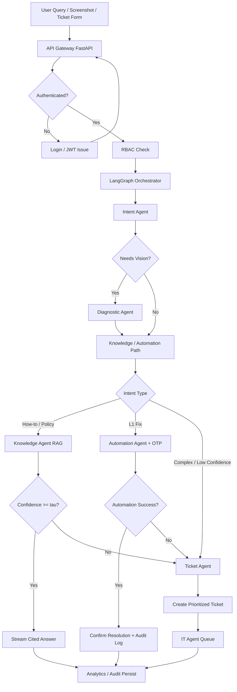

## 15.2 User Workflow

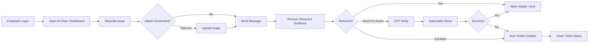

## 15.3 Admin Workflow

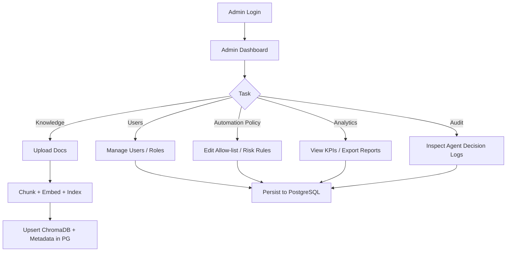

## 15.4 Data Processing Workflow

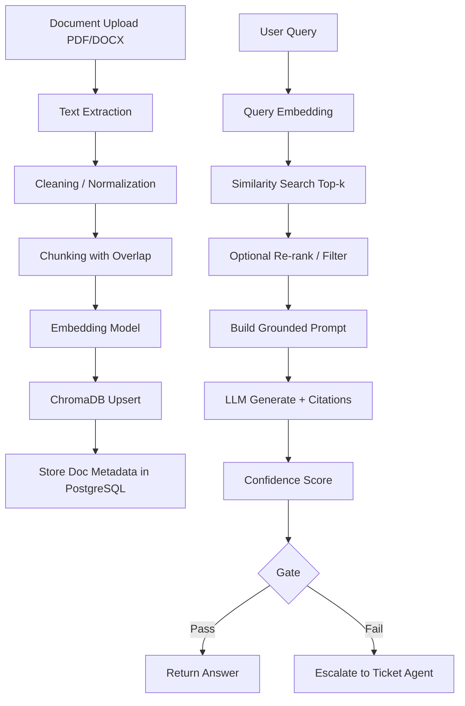

---

# 16. UML Diagrams

## 16.1 Use Case Diagram

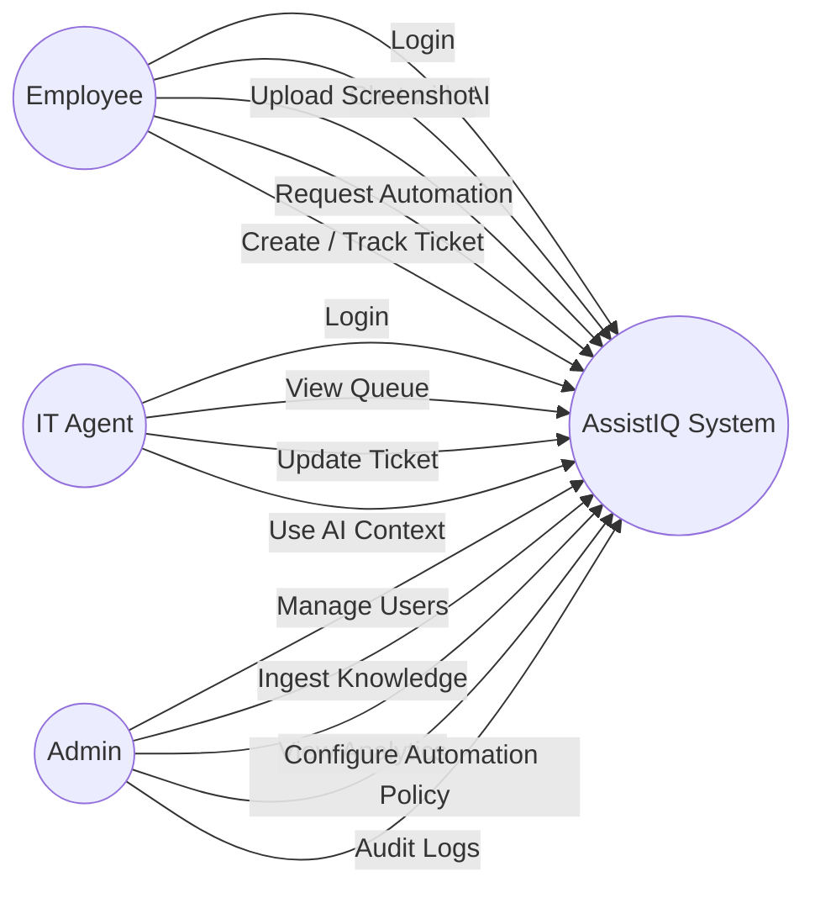

## 16.2 Activity Diagram (AI Resolution Path)

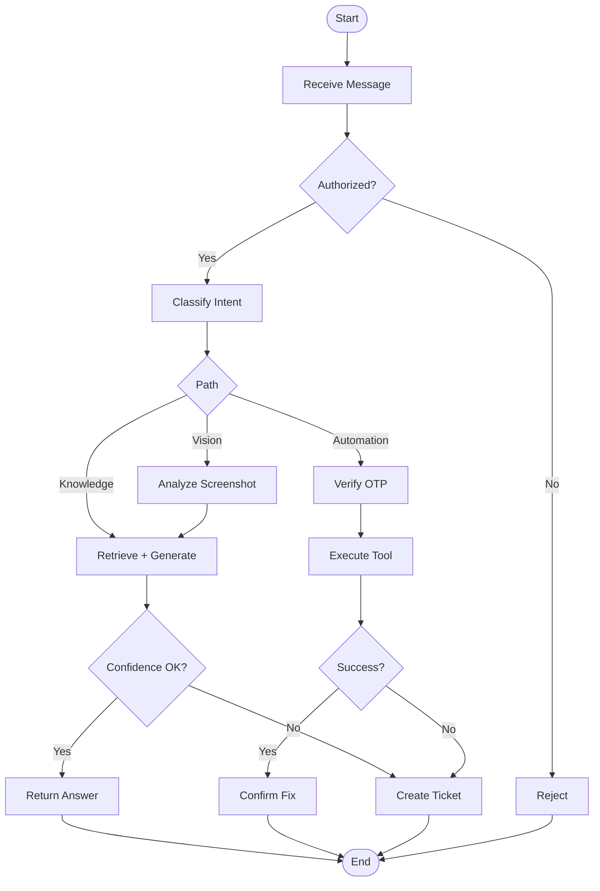

## 16.3 Sequence Diagram (Employee Chat to Automation / Escalation)

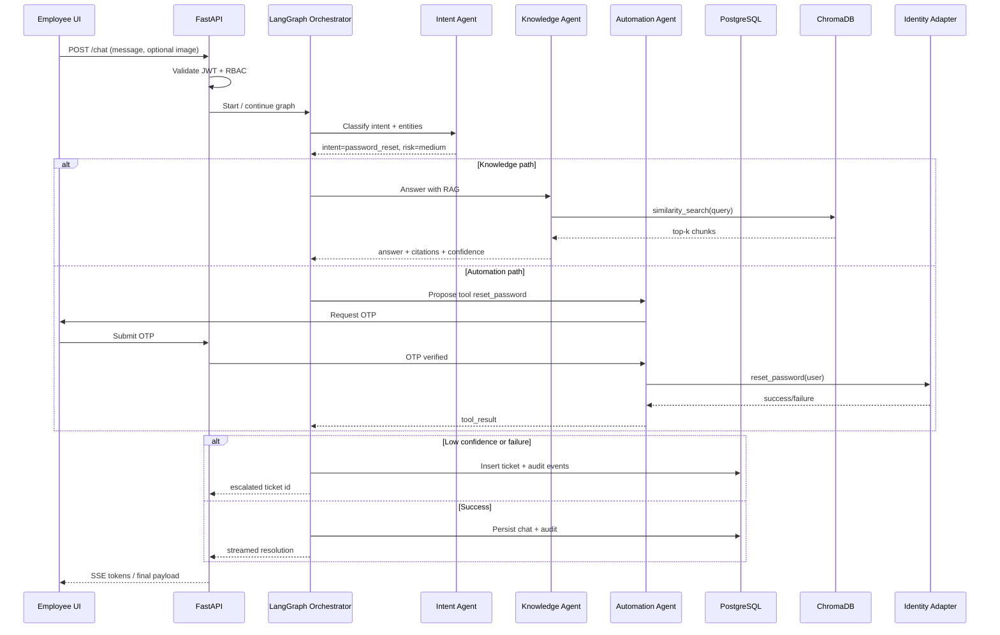

## 16.4 Class Diagram (Core Domain)

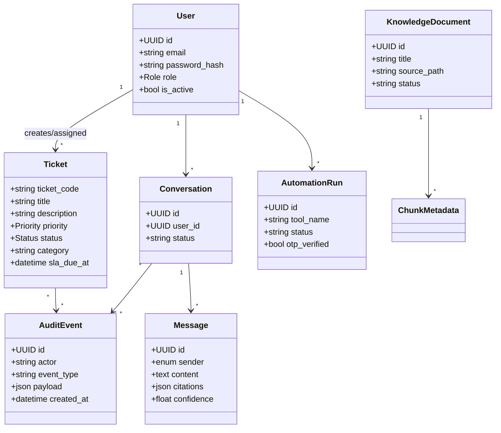

## 16.5 Component Diagram

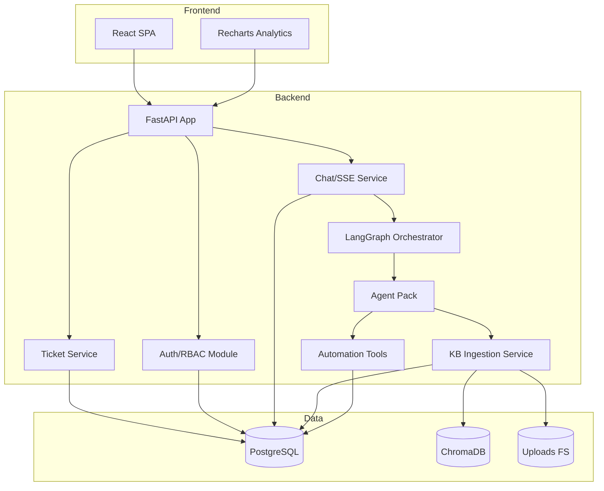

## 16.6 Deployment Diagram

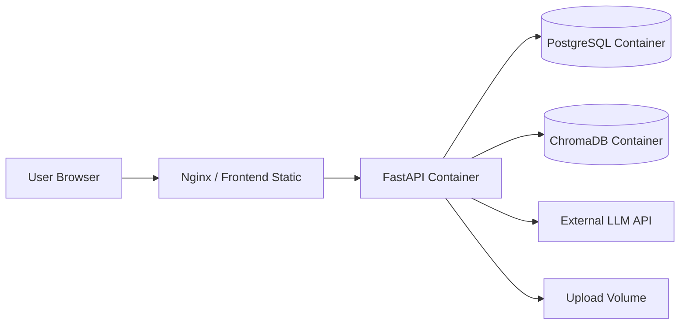

---

# 17. Database Design

## 17.1 ER Diagram

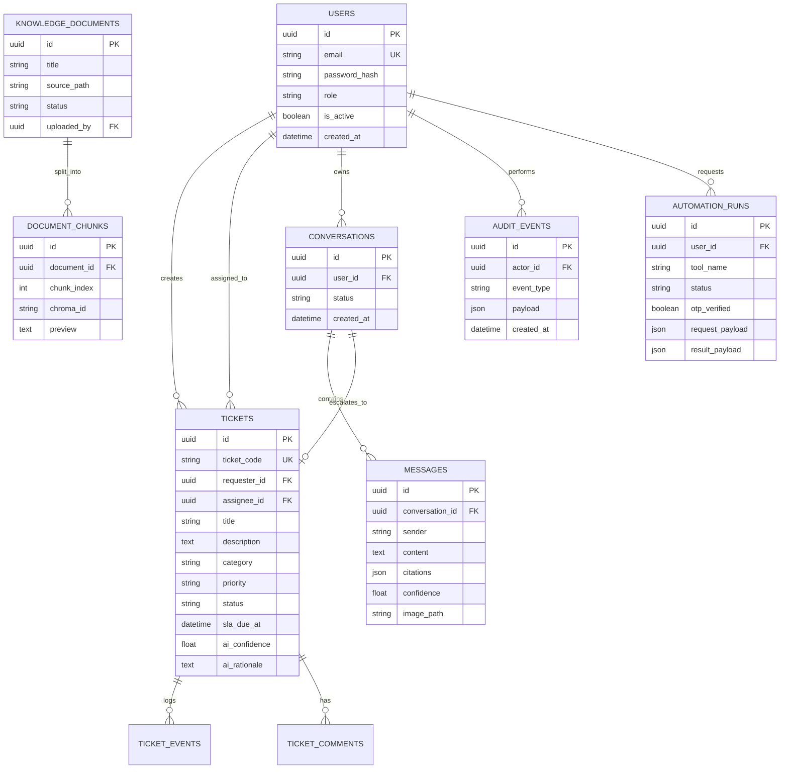

## 17.2 Tables (Summary)

- `users` — identity and roles
- `tickets` — ITSM core records
- `ticket_events` — immutable status/assignment history
- `ticket_comments` — human/AI comments
- `conversations`, `messages` — chat transcripts + citations
- `knowledge_documents`, `document_chunks` — KB registry mapped to Chroma IDs
- `automation_runs` — tool execution audit
- `audit_events` — cross-cutting security/ops audit
- `otp_challenges` — short-lived OTP records for automation gates

## 17.3 Relationships

- One user creates many tickets; one agent may be assigned many tickets.
- One conversation has many messages; optional escalation links conversation to ticket.
- One knowledge document has many chunks; chunks reference Chroma embeddings.
- One automation run belongs to one user and may reference a conversation/ticket.

## 17.4 Data Dictionary (Selected)

| Table.Column | Type | Description |
|---|---|---|
| users.role | ENUM | `employee`, `agent`, `admin` |
| tickets.priority | ENUM | `low`, `medium`, `high`, `critical` |
| tickets.status | ENUM | `new`, `triaged`, `in_progress`, `waiting`, `resolved`, `closed`, `cancelled` |
| tickets.sla_due_at | TIMESTAMP | Computed from priority policy |
| messages.citations | JSONB | `[{doc_id, title, chunk_id, score}]` |
| messages.confidence | FLOAT | 0–1 grounding/answer confidence |
| automation_runs.tool_name | VARCHAR | Allow-listed tool identifier |
| audit_events.event_type | VARCHAR | e.g., `agent.decision`, `auth.login`, `tool.exec` |

---

# 18. Algorithms / Logic

## 18.1 Intent Classification

**Approach:** LLM structured output (JSON schema) with few-shot IT examples, optionally preceded by lightweight keyword/heuristic prefilter for known L1 intents.

**Why:** Accurate enough for mini-project scale without training a custom classifier; schema validation prevents free-form drift; heuristics reduce cost/latency on obvious cases.

## 18.2 RAG Retrieve-then-Generate

1. Chunk documents with overlap (e.g., 500–800 tokens, 10–15% overlap).
2. Embed chunks and query with the same embedding model.
3. Retrieve top-k (k approximately 4–8); optional simple re-rank by metadata filters (product, OS).
4. Prompt LLM: answer **only** from context; emit citations; produce confidence.
5. If confidence is below threshold or context is empty, escalate.

**Why chosen:** Directly mitigates hallucination and knowledge-cutoff issues identified in literature; ChromaDB keeps ops light; citations support auditability (Objective 1 and 4).

## 18.3 Priority / SLA Scoring

Hybrid score combining urgency, impact, and sentiment penalty, mapped to Low/Medium/High/Critical; SLA due-at selected from policy table (e.g., Critical = 1h, High = 4h).

**Why:** Combines deterministic ITIL-style urgency/impact with NLP signals; rationale string stored for explainability.

## 18.4 Tool-Calling Automation

LLM may select only from allow-listed tools. Parameters validated by Pydantic models. OTP must be verified before side effects.

**Why:** Prevents arbitrary code execution; matches enterprise least-privilege; OTP closes account-takeover risk for password/unlock flows.

## 18.5 Vision Diagnosis

Multimodal prompt extracts: error text, likely product, probable cause hypotheses, next questions. OCR text concatenated into RAG query for grounded fixes.

**Why:** Real users attach screenshots; text-only bots miss critical evidence.

## 18.6 Confidence-Gated Escalation

Escalate when any holds: low RAG confidence, automation failure, high risk class (e.g., privilege changes beyond allow-list), user explicit request, repeated unresolved turns.

**Why:** Literature shows pure automation fails on ambiguous/high-stakes cases; this implements Objective 5.

---

# 19. Technology Stack

| Layer | Technology | Justification |
|---|---|---|
| Frontend | React + TypeScript | Strong typing for complex UI state; industry standard SPA for dashboards/chat |
| Styling | Tailwind CSS | Rapid, consistent utility styling for role-based layouts |
| Charts | Recharts | Lightweight React charts for MTTR/SLA visuals |
| Backend | FastAPI (Python) | Async-friendly, excellent for AI/streaming workloads, automatic OpenAPI |
| Orchestration | LangGraph | Explicit state machines for multi-agent routing and conditional escalation |
| LLM tooling | LangChain + provider SDK | Speeds RAG/tool-calling integration without locking to one vendor |
| Relational DB | PostgreSQL | Robust ACID store for tickets, users, audits |
| Vector DB | ChromaDB | Simple local/dev vector store ideal for mini-project RAG |
| Auth | JWT + bcrypt + HTTP-only refresh cookies | Stateless API auth with practical XSS mitigation |
| Realtime | SSE + WebSockets | SSE for LLM streams; WS for collaborative ticket events |
| Containers | Docker Compose | Reproducible demo/deployment |
| Vision | Multimodal LLM (+ OCR as needed) | Screenshot understanding without custom CV training |

**Selection rationale vs alternatives:** NestJS could replace FastAPI, but Python remains the path of least resistance for LangGraph/RAG ecosystems in a student timeline. Pinecone/Weaviate are stronger at scale but add cost/ops; ChromaDB is the better mini-project default. A single-agent chain would be simpler but fails transparency/audit objectives.

---

# 20. Implementation Plan

Objective-wise timeline suitable for a college mini project (15 phases across Foundation → Intelligence → Hardening).

| Phase | Focus | Objective(s) | Deliverable |
|---|---|---|---|
| 1–2 | Foundation | — | Auth, RBAC, role dashboards |
| 3–4 | Transparent surface | 4 | Ticket module + streaming AI chat |
| 5 | Grounded answers | 1 | KB ingestion + ChromaDB RAG |
| 6 | Modular agents | 4 | LangGraph multi-agent graph |
| 7 | Explainable triage | 1, 4 | Category/priority/SLA + rationale |
| 8 | Real execution | 2 | Automation tools + OTP gate |
| 9 | Vision | 1 | Screenshot diagnostic agent |
| 10 | Continuity | 1 | Cross-turn / cross-ticket memory |
| 11 | Collaboration | — | WebSocket live updates |
| 12 | Visibility | 6 | Analytics KPIs + exports |
| 13 | Optional channels | 3 | Slack/Teams/Email stubs (if time) |
| 14 | Safety | 5 | RBAC hardening, audit completeness, Docker |
| 15 | Delivery | All | Testing, docs, demo polish |

Suggested calendar (12–14 weeks): Weeks 1–3 Foundation; 4–9 Intelligence; 10–12 Hardening and Testing; 13–14 Documentation and Viva prep.

---

# 21. Testing Strategy

## 21.1 Unit Testing

- Auth: password hash verify, JWT claims, RBAC matrix
- RAG: chunker boundaries, citation assembly
- Automation: tool schema validation rejects unknown tools
- Priority scoring edge cases

## 21.2 Integration Testing

- Chat → Intent → Knowledge → response persistence
- Chat → Automation → OTP → adapter mock success/fail
- Escalation path creates ticket with linked conversation

## 21.3 System Testing

- End-to-end employee journeys on demo dataset
- Agent queue operations
- Admin ingestion → query returns new document citations
- Role isolation (employee cannot access admin endpoints)

## 21.4 Sample Test Cases

| ID | Scenario | Steps | Expected |
|---|---|---|---|
| TC-01 | Valid login | Employee credentials | JWT issued; dashboard loads |
| TC-02 | Invalid role access | Employee hits `/admin/analytics` | 403 Forbidden |
| TC-03 | RAG citation | Ask known KB question | Answer includes source citation |
| TC-04 | Low-confidence escalate | Ask out-of-KB question | Ticket created; user notified |
| TC-05 | Password reset happy path | Intent + OTP correct | Automation success under 60s (sandbox) |
| TC-06 | OTP failure | Wrong OTP | No side effect; audit logged |
| TC-07 | Screenshot diagnosis | Upload VPN error image | Extracted error + steps or escalate |
| TC-08 | Agent resolves ticket | Status → Resolved | Event trail immutable |
| TC-09 | Analytics | Seed resolved tickets | MTTR/deflection compute correctly |
| TC-10 | Streaming chat | Long answer | Tokens arrive via SSE without blocking |

---

# 22. Advantages

1. **Lower MTTR** for routine L1 via automation and instant RAG guidance.
2. **Ticket deflection** reduces agent load without hiding escalations.
3. **Grounded answers** with citations improve trust versus generic chatbots.
4. **Transparent multi-agent design** supports academic evaluation and enterprise audit.
5. **Affordable open stack** avoids proprietary ITSM AI licensing.
6. **Human-in-the-loop safety** for low-confidence/high-risk cases.
7. **Vision support** matches real helpdesk evidence patterns.
8. **Measurable KPIs** for continuous improvement.

---

# 23. Limitations

1. Answer quality still depends on KB freshness and chunking quality.
2. Mini-project automation uses sandbox adapters—not live production AD by default.
3. Multimodal diagnosis can misread unusual UI languages/themes.
4. LLM API latency/cost varies with provider quotas.
5. Omnichannel bots (Slack/Teams) may be incomplete in MVP.
6. No custom fine-tuned domain model; relies on prompt + RAG quality.
7. Multi-hop reasoning across many documents remains a hard RAG challenge.

---

# 24. Future Enhancements

1. Hybrid search (BM25 + vectors) and multi-hop Agentic RAG.
2. Native Slack/Teams apps with the same orchestrator.
3. Real Okta/Azure AD connectors with staged approvals for privileged actions.
4. Voice channel + meeting-bot summaries for major incidents.
5. Offline eval harness for citation faithfulness scoring.
6. CMDB-aware automation (impact analysis before changes).
7. On-prem LLM option for air-gapped enterprises.
8. Proactive detection (anomaly alerts creating tickets before users report).

---

# 25. Conclusion

AssistIQ presents a coherent, engineerable answer to the persistent Tier-1 overload problem in enterprise IT support. By combining RAG-grounded knowledge, vision diagnosis, OTP-gated automation, and confidence-aware escalation inside a transparent LangGraph multi-agent architecture, the platform addresses the cost, opacity, shallow automation, and hallucination gaps of existing commercial systems—while remaining realistically deliverable as a college mini project on an open technology stack.

The design prioritizes **precision over placeholders**: structured agent outputs, allow-listed tools, audit logs, and explicit policy gates. With the implementation plan and testing strategy above, AssistIQ can be demonstrated end-to-end—from employee chat to automated resolution or contextualized human ticket—establishing a strong academic and practical foundation for future enterprise extensions.

---

# 26. References

[1] ServiceNow Newsroom, “ServiceNow completes acquisition of Moveworks,” Dec. 2025. [Online]. Available: https://newsroom.servicenow.com

[2] Automation Anywhere, “Automation Anywhere Acquires Aisera to Supercharge the Autonomous Enterprise,” Nov. 2025. [Online]. Available: https://www.automationanywhere.com

[3] Workativ, “Espressive Reviews 2026: Pricing, Pros, Cons & Alternatives.” [Online]. Available: https://workativ.com

[4] PeerSpot, “Espressive Barista Reviews,” 2026. [Online]. Available: https://www.peerspot.com

[5] “AI-Powered Chatbots in Organizations: A Systematic Literature Review,” ResearchGate, Mar. 2025. [Online]. Available: https://www.researchgate.net/publication/390050498

[6] “Hallucination Mitigation for Retrieval-Augmented Large Language Models: A Review,” *MDPI Mathematics*, vol. 13, no. 5, Art. no. 856, Mar. 2025. [Online]. Available: https://www.mdpi.com/2227-7390/13/5/856

[7] “Retrieval-Augmented Generation: A Comprehensive Survey of Architectures, Enhancements, and Robustness Frontiers,” arXiv, 2025. [Online]. Available: https://arxiv.org/html/2506.00054v1

[8] T. Bruckhaus, “RAG does not work for enterprises,” arXiv:2406.04369, 2024.

[9] “Driving AI chatbot adoption: A systematic review of factors, barriers, and future research directions,” *ScienceDirect*, Jul. 2025.

[10] Pangea.app, “What is Aisera?” Feb. 2026. [Online]. Available: https://pangea.app/glossary/aisera

[11] eesel AI, “Moveworks 2026: ServiceNow-owned, no public pricing.” [Online]. Available: https://eesel.ai/blog/moveworks

[12] CorePiper, “5 Best Aisera Alternatives in 2026,” Apr. 2026. [Online]. Available: https://corepiper.com/blog/aisera-alternatives

[13] E. Uzok, Cadet, and Ojukwu, “Leveraging AI-Powered Chatbots to Enhance Customer Service Efficiency,” *Computer Science & IT Research Journal*, 2024.

[14] Aerospike, “Retrieval Augmented Generation for Enterprise AI Systems,” 2025.

[15] LangGraph Documentation, LangChain, 2025–2026. [Online]. Available: https://langchain-ai.github.io/langgraph/

[16] FastAPI Documentation, 2026. [Online]. Available: https://fastapi.tiangolo.com/

[17] ChromaDB Documentation, 2026. [Online]. Available: https://docs.trychroma.com/

[18] ITIL Foundation materials on Incident Management urgency/impact prioritization (Axelos), used as process reference for SLA policy design.

---

# APPENDIX A — PowerPoint-Ready Deck (15–20 Slides)

## Slide 1 — Title
- **Title:** AssistIQ: Autonomous GenAI IT Helpdesk
- **Bullets:** Mini Project Proposal · Multi-Agent · RAG · Automation · Human Escalation
- **Speaker notes:** Introduce team, college, guide; state one-line problem: L1 overload + expensive opaque AI tools.
- **Diagram:** Logo + architecture silhouette.
- **Icons:** Headset, robot, shield.

## Slide 2 — Agenda
- Problem → Literature → Objectives → Architecture → Modules → Demo → Testing → Conclusion
- **Notes:** Keep to 8–10 minutes speaking; rest for demo/viva.
- **Icons:** Numbered list.

## Slide 3 — Problem Statement
- High volume of repetitive L1 tickets
- Slow first response; scattered knowledge
- Manual triage → inconsistent SLAs
- Formal statement quote
- **Notes:** Use a concrete example (VPN down at 9 AM).
- **Diagram:** Pain funnel (Employee → Ticket Queue → Delay).
- **Icons:** Clock, queue, broken link.

## Slide 4 — Existing Systems
- ServiceNow VA, Moveworks, Aisera, Espressive
- Benefits: deflection, omnichannel, RAG-like search
- **Notes:** Mention 2025 acquisitions briefly as market evidence of consolidation.
- **Diagram:** Comparison table (Cost / Transparency / Real Automation).
- **Icons:** Building, lock, dollar.

## Slide 5 — Research Gap
- Costly and vendor-locked
- Opaque reasoning
- Routing greater than execution
- RAG hallucination risk
- Weak human-in-loop design in DIY bots
- **Notes:** Emphasize AssistIQ fills all five, not one.
- **Icons:** Gap / puzzle piece.

## Slide 6 — Objectives (6)
- Grounded RAG answers
- Real tool-calling automation
- Affordable open stack
- Transparent multi-agent logs
- Confidence-gated escalation
- Analytics KPIs
- **Notes:** Map each objective to a later slide/module.
- **Icons:** Target checklist.

## Slide 7 — Proposed System Overview
- Role-aware web platform
- 10 core capabilities (group into Auth, AI, Tickets, Analytics)
- Sandbox-safe automation for demo
- **Notes:** Clarify what is live vs simulated.
- **Diagram:** 3-actor diagram (Employee/Agent/Admin).
- **Icons:** Users triad.

## Slide 8 — System Architecture
- React → FastAPI → LangGraph Agents → PG + Chroma
- **Notes:** Walk left-to-right once; don’t deep-dive yet.
- **Diagram:** Architecture block diagram (from Section 12).
- **Icons:** Layers.

## Slide 9 — Multi-Agent Design
- Intent · Diagnostic · Knowledge · Automation · Ticket
- LangGraph conditional routing
- Structured JSON outputs
- **Notes:** Why not one prompt? Auditability + safety gates.
- **Diagram:** Agent star/orchestrator.
- **Icons:** Network nodes.

## Slide 10 — RAG Knowledge Pipeline
- Ingest → Chunk → Embed → Retrieve → Cite → Confidence gate
- **Notes:** Show a citation example on screen.
- **Diagram:** Data processing Mermaid rendered.
- **Icons:** Book + magnifier.

## Slide 11 — Automation + Security
- Allow-listed tools only
- OTP before side effects
- Full audit trail
- JWT + RBAC
- **Notes:** Examiner hot topic—stress least privilege.
- **Diagram:** OTP sequence snippet.
- **Icons:** Key, OTP pad, shield.

## Slide 12 — Modules Snapshot
- Auth, Dashboard, Tickets, Chat, KB, Agents, Vision, Analytics
- **Notes:** One sentence each; point to demo screens.
- **Diagram:** Module grid.
- **Icons:** App tiles.

## Slide 13 — Workflows
- Overall + User + Escalation
- **Notes:** Narrate one happy path and one escalate path.
- **Diagram:** Overall system Mermaid.
- **Icons:** Flow arrows.

## Slide 14 — Database and Stack
- PostgreSQL entities + Chroma vectors
- Tech stack with one-line justifications
- **Notes:** Be ready to justify FastAPI + LangGraph + Chroma.
- **Diagram:** ER thumbnail + stack logos.
- **Icons:** DB cylinder, React/Python logos.

## Slide 15 — Implementation Plan
- 15 phases / 3 waves
- 12–14 week calendar
- **Notes:** Show what is done vs planned honestly.
- **Diagram:** Gantt or phase bars.
- **Icons:** Calendar.

## Slide 16 — Testing Strategy
- Unit / Integration / System
- Sample TCs (RAG cite, OTP fail, escalate)
- **Notes:** Bring one test log screenshot if available.
- **Icons:** Checklist, bug.

## Slide 17 — Advantages and Limitations
- MTTR down, deflection up, citations, open cost
- Limits: KB quality, sandbox AD, LLM cost
- **Notes:** Owning limitations scores viva marks.
- **Icons:** Plus/minus.

## Slide 18 — Future Enhancements
- Hybrid/Agentic RAG, real IdP, Slack/Teams, on-prem LLM
- **Notes:** Tie each to a current limitation.
- **Icons:** Rocket.

## Slide 19 — Demo Plan
- Screens + scripted flow (see Appendix B)
- **Notes:** Rehearse failure case (escalate) — examiners love it.
- **Icons:** Play button.

## Slide 20 — Conclusion and Q&A
- AssistIQ = grounded + automated + auditable + escalates safely
- Thank you / Questions
- **Notes:** Restate problem → gap → solution in 20 seconds.
- **Icons:** Checkered flag.

---

# APPENDIX B — Demo, UI, and Viva Pack

## B.1 UI Screens to Demonstrate

1. Login (role selector or distinct users)
2. Employee dashboard
3. AI Chat (streaming + citations)
4. Screenshot upload diagnosis
5. OTP modal for password reset
6. Automation success confirmation
7. Auto-created ticket detail (with AI rationale)
8. IT Agent queue + SLA timers
9. Admin KB upload + document list
10. Analytics dashboard (MTTR, deflection)
11. Audit log viewer (agent decisions)

## B.2 Recommended Demo Flow (6–8 minutes)

1. **Login as Employee** → show dashboard.
2. **Ask KB question** (“How do I connect to VPN?”) → cited answer.
3. **Upload screenshot** of a fake error → diagnostic steps.
4. **Request password reset** → OTP → sandbox success under 1 minute narrative.
5. **Ask unknown/complex question** → low confidence → ticket `TICK-…` created.
6. **Switch to IT Agent** → open escalated ticket → show transcript + citations + priority rationale.
7. **Switch to Admin** → analytics tiles + audit event for tool execution.

## B.3 Examiner Questions and Strong Answers

**Q1. Why multi-agent instead of one chatbot?**  
**A:** Separation of concerns enables per-step logging, independent testing, and explicit policy gates (confidence, OTP, risk). A single prompt hides failures and weakens auditability—contradicting Objective 4.

**Q2. How do you prevent hallucinations?**  
**A:** Retrieve-then-generate RAG, force citations from retrieved chunks, and escalate when confidence is below threshold or context is empty—not free-form generation.

**Q3. How is automation safe?**  
**A:** Allow-listed tools only, Pydantic parameter validation, OTP identity gate, sandbox adapter in mini project, and immutable audit of every tool call. No arbitrary shell from the LLM.

**Q4. Why ChromaDB not Pinecone?**  
**A:** Mini-project constraints favor local, low-ops vector storage with adequate performance for curated IT corpora; architecture can swap to managed vector DB later without changing agent contracts.

**Q5. Why FastAPI?**  
**A:** Native async, first-class streaming responses, Python ecosystem fit for LangGraph/RAG, automatic OpenAPI for frontend integration.

**Q6. What is your research gap vs ServiceNow/Moveworks?**  
**A:** Those platforms are costly and consolidating into vendor lock-in; often stronger at deflection/routing than transparent multi-step execution. AssistIQ targets affordable, auditable, tool-calling automation with confidence-gated escalation on an open stack.

**Q7. How is priority decided?**  
**A:** Hybrid urgency × impact (+ sentiment penalty) with model-assisted classification; SLA due-at from policy table; rationale persisted on the ticket.

**Q8. What if RAG retrieves wrong chunks?**  
**A:** Limit top-k, metadata filters, confidence gate, user escalation control; future work adds hybrid BM25+vector and faithfulness eval. We do not claim perfect retrieval.

**Q9. Is Active Directory really integrated?**  
**A:** Mini-project uses a sandbox Identity Adapter implementing the same interface as production AD/IdP connectors—demonstrating architecture safely. Live directory writes are out of scope unless a lab directory is provided.

**Q10. Non-functional security highlights?**  
**A:** bcrypt hashes, short-lived JWT, HTTP-only refresh cookies, RBAC middleware, least-privilege tools, no secrets in logs, audit events for auth and automation.

## B.4 Viva Preparation Notes

- Memorize the **formal problem statement** and **five research-gap bullets**.
- Draw from memory: **LangGraph agent graph** and **RAG pipeline**.
- Know definitions: MTTR, FCR, deflection/containment, RAG, tool calling, RBAC, SSE vs WebSocket.
- Be honest about **sandbox automation** and **KB dependence**.
- Prepare one **failure demo story** (wrong OTP / low confidence → ticket).
- Map each objective to a module you can point to in the UI.
- Keep IEEE references [1]–[12] handy for literature questions.
- If asked “novelty,” answer: *composition + transparency + gated automation on open stack for ITSM L1*, not inventing LLMs.

---

*End of Complete Project Proposal — AssistIQ*
