# ASSISTIQ
## Autonomous GenAI-Powered Enterprise IT Helpdesk Platform

### Project Proposal & Software Design Document (SDD)

| Field | Detail |
|:---|:---|
| **Document Type** | Mini Project Proposal · Technical Design · Final Documentation Pack |
| **Project Title** | AssistIQ — Autonomous GenAI IT Helpdesk |
| **Domain** | Enterprise IT Service Management (ITSM) · Agentic AI · RAG |
| **Tech Stack** | React + TypeScript · FastAPI · LangGraph · ChromaDB · PostgreSQL · Docker |
| **Document Version** | 2.0 |
| **Prepared** | August 2026 |
| **Classification** | Academic / Internal Design |

---

> **Document purpose.** This Software Design Document (SDD) defines the problem, architecture, workflows, data model, APIs, security model, UI plan, roadmap, and viva materials for AssistIQ. It is written for conversion to DOCX/PDF and for direct use in PPT and final project submission.

> **Assumptions (explicit).** Items marked **[Assumption]** are engineering inferences added where source materials did not specify production detail. They are realistic for a college mini project and can be revised during implementation.

---

# 1. Cover Page

```
╔══════════════════════════════════════════════════════════════════╗
║                                                                  ║
║                         A S S I S T I Q                          ║
║                                                                  ║
║     An Autonomous, GenAI-Powered Enterprise IT Helpdesk          ║
║                                                                  ║
║     Project Proposal & Software Technical Design Document        ║
║                                                                  ║
║     Multi-Agent Orchestration · RAG · Vision · Secure Automation ║
║                                                                  ║
║     Stack: React · TypeScript · FastAPI · LangGraph ·            ║
║            PostgreSQL · ChromaDB · JWT/RBAC · Docker             ║
║                                                                  ║
║     Version 2.0  ·  August 2026                                  ║
║                                                                  ║
╚══════════════════════════════════════════════════════════════════╝
```

**Submitted for:** Mini Project / Final Year Project Documentation  
**Suitable for:** Proposal · Architecture Review · PPT · Viva · Final Report  

---

# 2. Table of Contents

1. Cover Page  
2. Table of Contents  
3. Executive Summary  
4. Abstract  
5. Introduction  
6. Problem Statement  
7. Literature Review  
8. Objectives  
9. Proposed Solution  
10. Scope of the Project  
11. Functional Requirements  
12. Non-Functional Requirements  
13. System Architecture  
14. Workflow  
15. UML Diagrams  
16. Database Design  
17. Module-wise Explanation  
18. Algorithms / Business Logic  
19. Technology Stack  
20. Project Architecture Explanation  
21. API Design  
22. Security Considerations  
23. Testing Strategy  
24. Advantages  
25. Limitations  
26. Future Enhancements  
27. Development Roadmap  
28. UI/UX Planning  
29. PPT Preparation  
30. Viva Preparation  
31. References  

---

# 3. Executive Summary

AssistIQ is an autonomous IT helpdesk platform that resolves Tier-1 (L1) employee issues through a transparent multi-agent AI system, while escalating complex or low-confidence cases to human engineers with full context.

**Business problem.** IT teams spend disproportionate time on password resets, VPN failures, software access, and account unlocks. Knowledge is scattered; triage is manual; SLAs drift.

**Solution thesis.** Replace opaque single-bot chat with a LangGraph-orchestrated pipeline of specialized agents—Intent, Diagnostic (vision), Knowledge (RAG), Automation (tool calling), and Ticket—backed by PostgreSQL, ChromaDB, JWT/RBAC, OTP-gated actions, and auditable decision logs.

**Differentiation.** Unlike costly, vendor-locked enterprise AI helpdesks (ServiceNow Virtual Agent, Moveworks, Aisera, Espressive), AssistIQ is built on open tooling and general-purpose LLM APIs, optimized for affordability, explainability, and real task execution—not only conversational routing.

**Outcomes targeted.** Sub-minute sandbox resolution for routine L1 fixes, citation-backed answers, measurable ticket deflection, lower MTTR, and contextualized human handoff when automation is unsafe or insufficient.

---

# 4. Abstract

Enterprise IT support remains bottlenecked by high volumes of repetitive L1 incidents. Commercial AI platforms partially automate deflection but introduce cost, opacity, shallow automation, and RAG reliability risks.

This document specifies **AssistIQ**, a web-based GenAI helpdesk that integrates Retrieval-Augmented Generation (RAG), multimodal screenshot diagnosis, allow-listed function calling for L1 automations, and confidence-gated escalation. The system uses FastAPI, React + TypeScript, PostgreSQL, ChromaDB, and LangGraph with role-based access control.

The contribution is a production-minded, mini-project-deliverable architecture that prioritizes grounded answers, secure automation, and auditability without proprietary ITSM licensing.

**Keywords:** Agentic AI, IT Helpdesk, RAG, LangGraph, ITSM, FastAPI, Human-in-the-Loop, RBAC

---

# 5. Introduction

Organizations depend on IT service desks to restore employee productivity. A large share of tickets are L1: credential resets, VPN connectivity, installation guidance, and account unlocks. Classical ITSM tools emphasize queues and forms; they do not autonomously diagnose, ground answers in internal docs, or execute verified fixes.

LLMs enable conversational support, but unconstrained chatbots hallucinate, skip identity checks, and hide reasoning. Enterprise AI helpdesk products exist, yet 2025 vendor consolidations intensified lock-in and pricing pressure.

AssistIQ treats support as an **orchestrated decision graph**: classify intent → optionally analyze screenshots → retrieve grounded knowledge → execute allow-listed tools under OTP → or open a prioritized ticket with transcript, citations, and rationale. This SDD details how that system is designed, secured, tested, demonstrated, and defended in viva.

---

# 6. Problem Statement

IT helpdesks are overloaded by repetitive L1 work. Employees wait; engineers lose time; knowledge stays fragmented; triage remains manual; SLAs become inconsistent. Existing AI tools help partially but leave gaps in cost, transparency, execution depth, and answer reliability.

> **Formal statement:** Organizations need an AI-driven IT helpdesk that understands natural-language issues, retrieves accurate answers from internal documentation, autonomously resolves common issues under verified identity controls, and transparently escalates complex ones—without the cost, rigidity, and opacity of existing enterprise AI support platforms.

---

# 7. Literature Review

## 7.1 Existing Systems

| System | Role in market (2026) |
|:---|:---|
| ServiceNow Virtual Agent | Native ITSM chatbot inside ServiceNow workflows; paired with Moveworks post-acquisition |
| Moveworks (ServiceNow) | Conversational enterprise search / AI front door; ~$2.85B acquisition closed Dec 2025 |
| Aisera (Automation Anywhere) | Omnichannel virtual agent + broad integrations; acquired Nov 2025; historically high ACV |
| Espressive Barista | IT/HR deflection agent; password/access workflows; reported 40–60% call reduction in case studies |
| Academic chatbot/RAG systems | Optimize routine ops; struggle with legacy integration and trust |

## 7.2 Similar Projects

Adjacent academic/industry builds include RAG internal-knowledge bots, ITIL-aligned chat assistants, LangChain/LangGraph multi-agent demos, and vision-assisted troubleshooting tools. Few combine **cited RAG + OTP-gated tool automation + confidence escalation + full audit trail** in a single open-stack mini-project architecture.

## 7.3 Benefits of Existing Systems

- High deflection potential for routine inquiries  
- RAG improves specificity vs generic LLM replies  
- Omnichannel + prebuilt ITSM workflows for large buyers  

## 7.4 Limitations of Existing Systems

- Expensive contracts and vendor lock-in after consolidation  
- Stronger at routing/deflection than deep multi-step execution  
- RAG quality depends on messy enterprise corpora; hallucination risk persists  
- Trust/integration barriers remain  
- Automation-only designs fail on ambiguous/high-stakes cases  

## 7.5 Research Gap

Need for an open, modular, auditable multi-agent IT helpdesk that:

1. cites sources and gates on confidence,  
2. executes allow-listed L1 actions with identity verification,  
3. escalates with full context,  
4. avoids proprietary ITSM AI licensing,  
5. logs per-agent decisions.

**AssistIQ is designed to occupy this gap.**

---

# 8. Objectives

1. **Ground answers** in company documents via RAG with citations and confidence thresholds.  
2. **Execute real L1 tasks** (password reset, unlock, VPN restore) via tool calling + OTP.  
3. **Remain affordable** using general LLM APIs and open stack components.  
4. **Expose transparent reasoning** through modular agents and persistent audit logs.  
5. **Escalate safely** when confidence is low or risk is high.  
6. **Measure operations** via MTTR, deflection, FCR, and SLA analytics.

---

# 9. Proposed Solution

AssistIQ is a role-aware web platform (Employee / IT Agent / Admin) with:

- Conversational AI chat (SSE streaming)  
- Screenshot vision diagnosis  
- ChromaDB-backed RAG knowledge base  
- LangGraph multi-agent orchestration  
- OTP-gated automation via sandbox Identity Adapter **[Assumption: sandbox IdP for mini-project; same interface as production AD/Okta]**  
- Intelligent ticket creation with category/priority/SLA rationale  
- Analytics and immutable audit events  

### Solution positioning

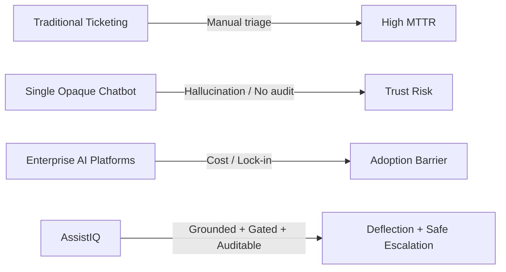

**Note:** AssistIQ does not invent a new LLM. Its novelty is the **composed, policy-gated ITSM workflow** on an open stack suitable for academic delivery and enterprise extension.

---

# 10. Scope of the Project

## 10.1 In Scope

- Web app for three roles  
- Auth (JWT + RBAC)  
- AI chat + SSE  
- RAG KB ingestion (PDF/DOCX)  
- Five-agent LangGraph orchestrator  
- Vision screenshot path  
- Sandbox automation + OTP  
- Tickets, SLA timers, activity log  
- Analytics KPIs  
- Docker Compose demo packaging  

## 10.2 Out of Scope

- Live campus AD write access by default  
- Production Slack/Teams bots (optional stretch)  
- Custom fine-tuned models  
- Full CMDB / change management  
- Voice/IVR  

## 10.3 Assumptions

| ID | Assumption |
|:---|:---|
| A-01 | Sample IT policy/VPN docs are available for RAG demos |
| A-02 | LLM API keys are available in the student environment |
| A-03 | Automation targets a mock Identity Adapter unless lab AD is provided |
| A-04 | Confidence threshold τ defaults to 0.55 and is admin-configurable |
| A-05 | Priority→SLA mapping follows a simple policy table (Critical 1h, High 4h, Medium 8h, Low 24h) |

---

# 11. Functional Requirements

| ID | Requirement |
|:---|:---|
| FR-01 | Authenticate users; enforce Employee / Agent / Admin roles |
| FR-02 | Stream AI chat responses to employees |
| FR-03 | Accept screenshot uploads for diagnosis |
| FR-04 | Return citation-backed RAG answers |
| FR-05 | Classify intent and route agent workflows |
| FR-06 | Execute allow-listed automations only after OTP verification |
| FR-07 | Auto-create tickets on low confidence, failure, or user escalation |
| FR-08 | Assign category, priority, SLA, and rationale |
| FR-09 | Let agents view queues, transcripts, citations |
| FR-10 | Let admins manage KB, users, policies, analytics, audits |
| FR-11 | Persist immutable audit events |
| FR-12 | Provide role-tailored dashboards |

---

# 12. Non-Functional Requirements

| ID | Category | Requirement |
|:---|:---|:---|
| NFR-01 | Security | bcrypt; short-lived JWT; HTTP-only refresh; RBAC on all protected APIs |
| NFR-02 | Reliability | Automation failures escalate; no silent drops |
| NFR-03 | Performance | Interactive SSE; sandbox automation target < 60s |
| NFR-04 | Scalability | Stateless API; separable PG + Chroma |
| NFR-05 | Usability | Role UX; markdown chat; visible citations |
| NFR-06 | Auditability | Log agent hops, tool calls, OTP, ticket transitions |
| NFR-07 | Maintainability | Structured agent schemas; typed frontend |
| NFR-08 | Deployability | Docker Compose for local demo |
| NFR-09 | Privacy | Least privilege; no secrets in logs |

---

# 13. System Architecture

## 13.1 High-Level Architecture Diagram

```mermaid
flowchart TB
    subgraph Clients
      E[Employee Browser]
      A[IT Agent Browser]
      AD[Admin Browser]
    end

    subgraph Edge
      FE[React + TypeScript SPA]
    end

    subgraph Platform["AssistIQ Platform"]
      API[FastAPI Gateway]
      AUTH[JWT + RBAC Middleware]
      ORCH[LangGraph Orchestrator]
      INT[Intent Agent]
      VIS[Diagnostic Agent]
      KNOW[Knowledge Agent]
      AUTO[Automation Agent]
      TKT[Ticket Agent]
    end

    subgraph Data
      PG[(PostgreSQL)]
      CH[(ChromaDB)]
      FS[(Uploads Volume)]
    end

    subgraph External
      LLM[LLM Provider API]
      IDP[Identity Adapter Sandbox/AD]
    end

    E --> FE
    A --> FE
    AD --> FE
    FE -->|REST / SSE / WS| API
    API --> AUTH
    AUTH --> ORCH
    ORCH --> INT & VIS & KNOW & AUTO & TKT
    KNOW --> CH
    KNOW --> LLM
    VIS --> LLM
    INT --> LLM
    AUTO --> IDP
    TKT --> PG
    API --> PG
    API --> FS
```

**Note:** The SPA never talks to agents or databases directly. All intelligence flows through the FastAPI gateway and orchestrator, preserving auth, validation, and audit boundaries.

## 13.2 Component Diagram

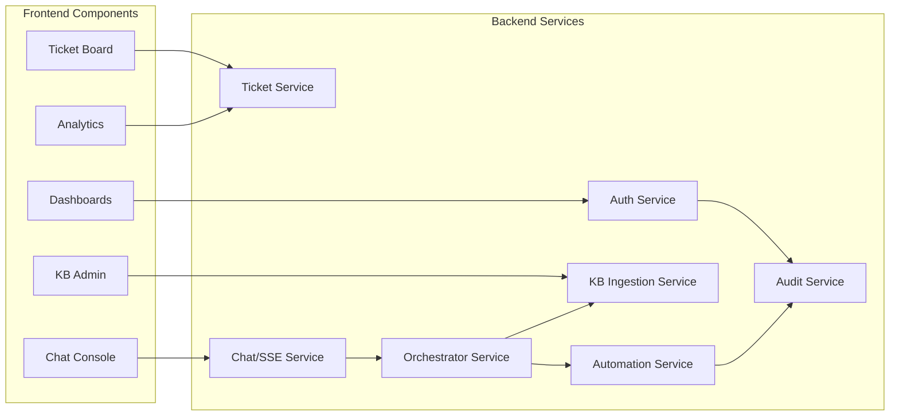

**Note:** Services are logical modules inside one FastAPI process for the mini project; they can be split into microservices later without changing UI contracts.

## 13.3 Deployment Diagram

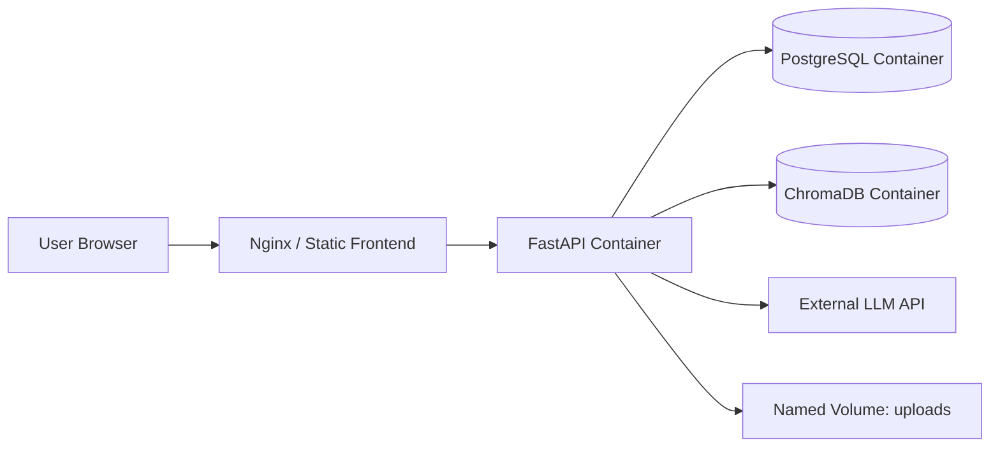

**Note:** Docker Compose is the reference demo topology. **[Assumption]** Nginx serves the built React assets and reverse-proxies `/api`.

---

# 14. Workflow

## 14.1 Overall System Workflow

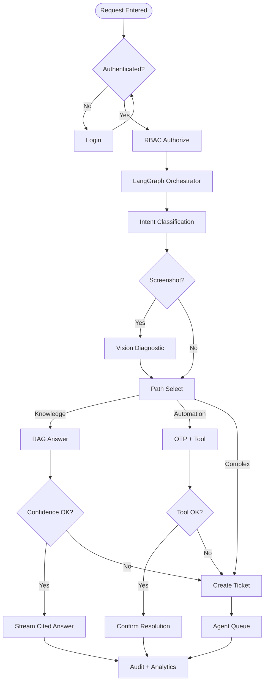

**Note:** Every terminal path writes audit events so deflection and escalation are measurable.

## 14.2 User Workflow

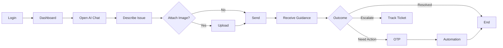

**Note:** Employees never need ITSM jargon; escalation is one click or automatic.

## 14.3 Admin Workflow

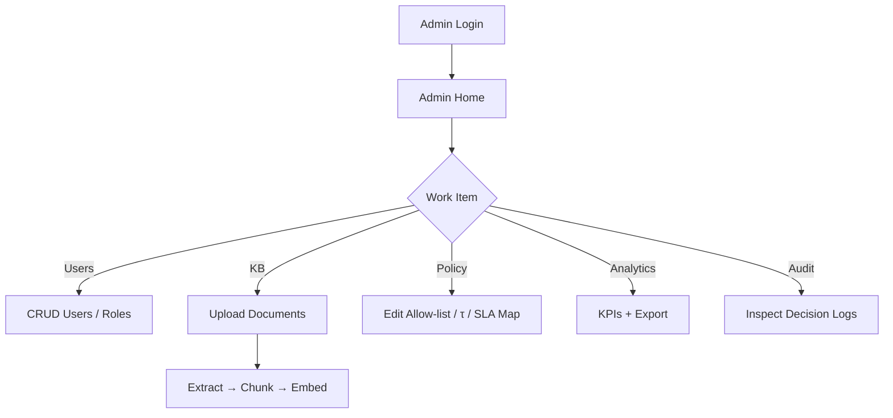

**Note:** KB freshness is an operational responsibility; poor docs degrade RAG quality by design.

## 14.4 Backend Processing Workflow

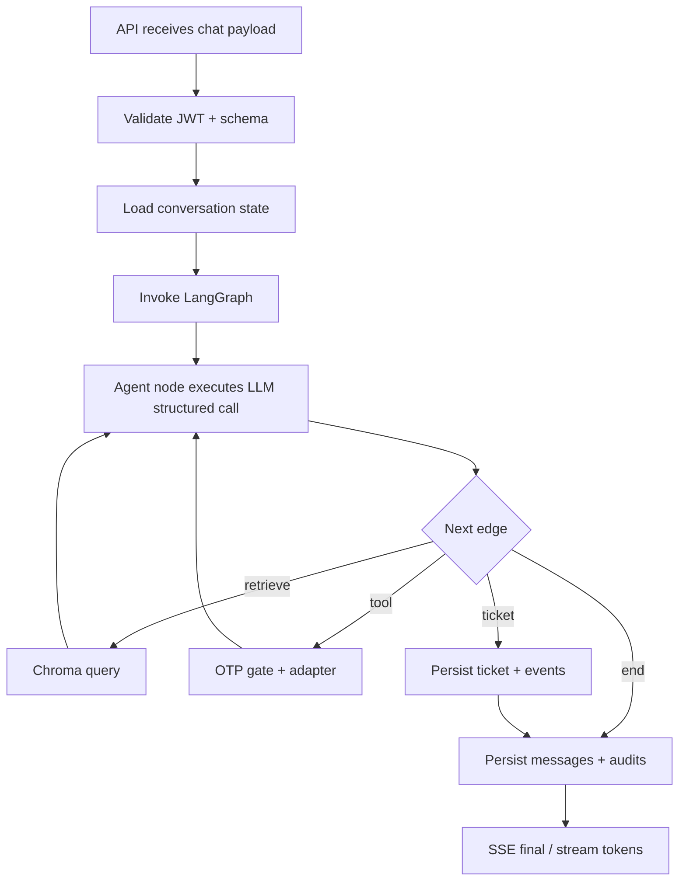

**Note:** Structured JSON schemas on agent outputs prevent uncontrolled free-text control flow.

## 14.5 Data Flow Diagram — Level 0

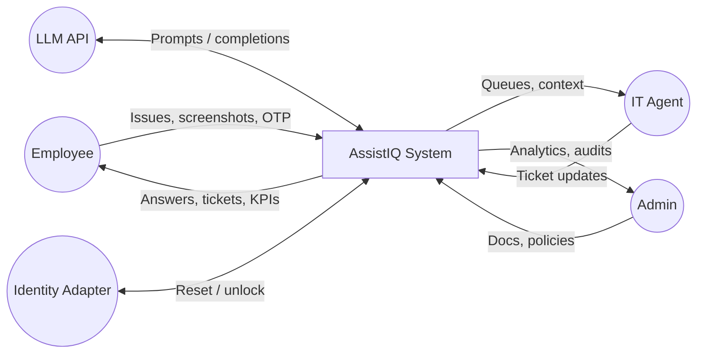

**Note (DFD-0):** AssistIQ is the single process boundary interacting with humans and external AI/identity services.

## 14.6 Data Flow Diagram — Level 1

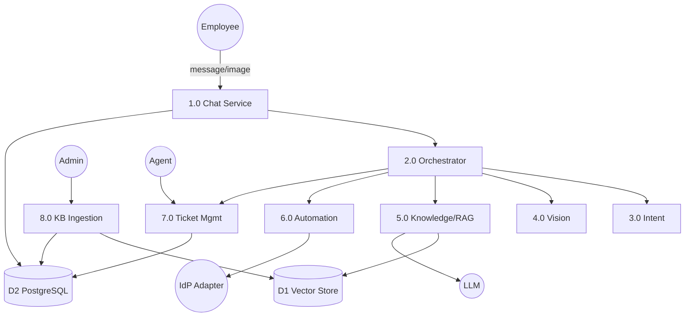

**Note (DFD-1):** Major transforms are numbered; data stores are D1 (vectors) and D2 (relational).

## 14.7 Decision Flow

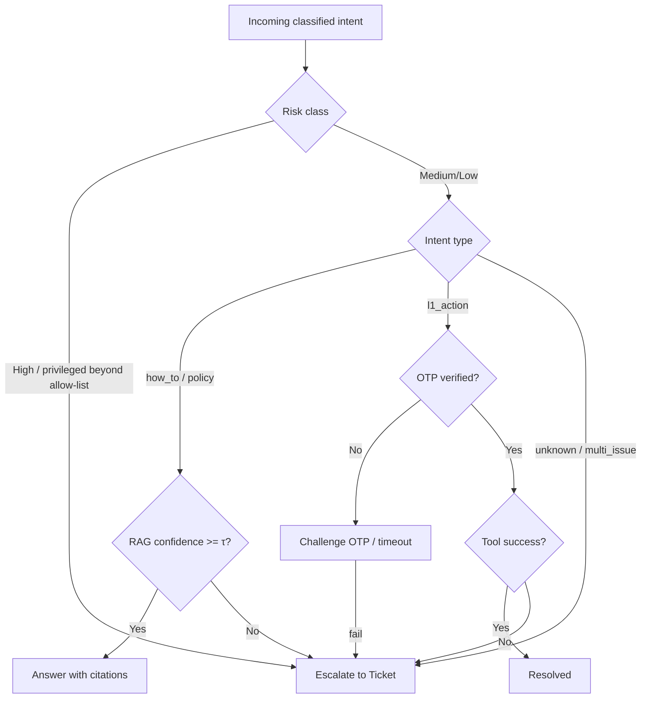

**Note:** Decision policy is explicit and testable—critical for viva defense of “why it escalated.”

## 14.8 Exception Handling Flow

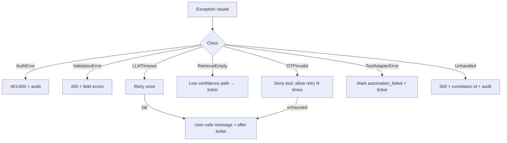

**Note:** Exceptions never execute tools. Correlation IDs link UI errors to audit rows. **[Assumption]** LLM retry count = 1.

---

# 15. UML Diagrams

## 15.1 Use Case Diagram

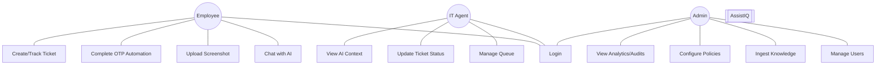

**Note:** Use cases cluster by role; Login is shared.

## 15.2 Activity Diagram

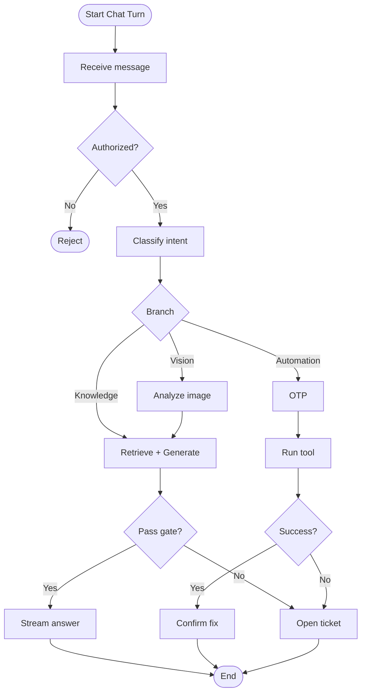

**Note:** Activity view emphasizes control gates (auth, confidence, OTP, tool success).

## 15.3 Sequence Diagram

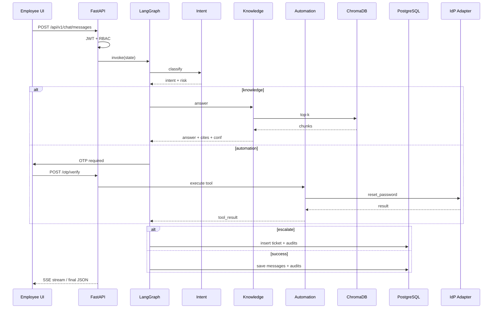

**Note:** OTP is an explicit round-trip before side effects.

## 15.4 Class Diagram

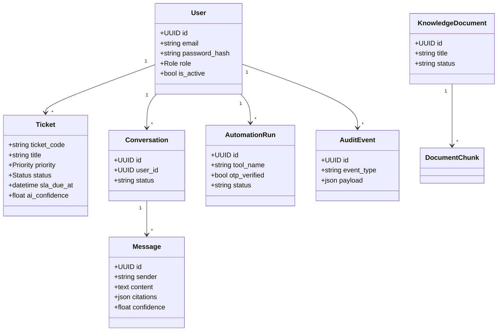

**Note:** Domain classes mirror PostgreSQL tables; vectors live outside ORM in Chroma.

## 15.5 State Diagram (Ticket Lifecycle)

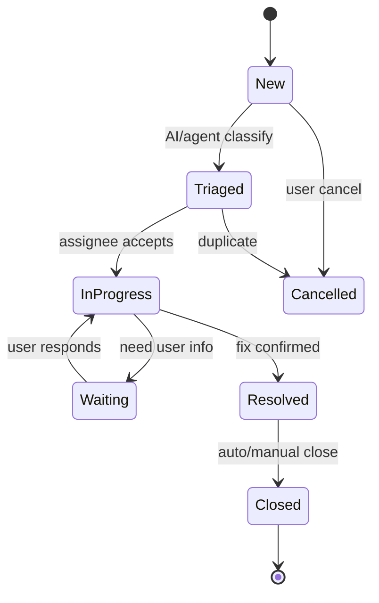

**Note:** AI-escalated tickets enter at **New** with prefilled triage fields, then typically move quickly to **Triaged**.

## 15.6 Component Diagram (UML view)

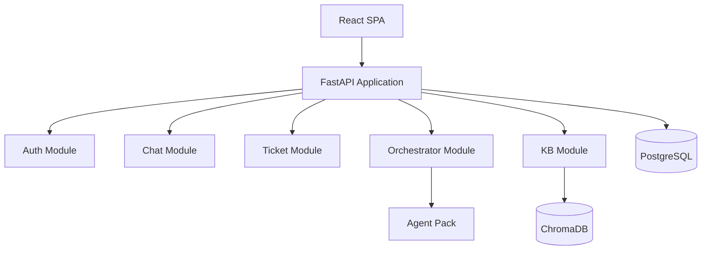

**Note:** Same logical decomposition as §13.2, redrawn for UML component convention.

## 15.7 Deployment Diagram (UML view)

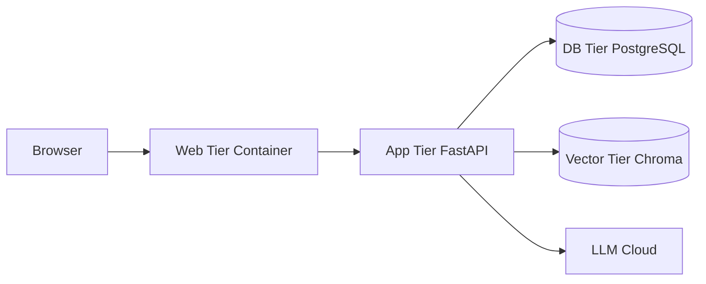

**Note:** Three tiers locally; LLM remains external SaaS for the mini project. **[Assumption]**

---

# 16. Database Design

## 16.1 ER Diagram

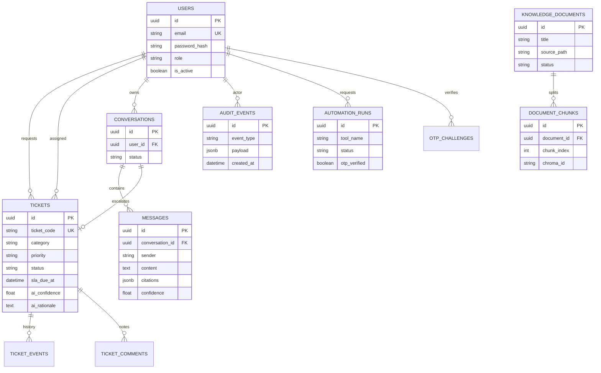

**Note:** Chroma stores embeddings; `document_chunks.chroma_id` is the join key for citations.

## 16.2 Database Schema (Logical)

**Relational (PostgreSQL):** users, tickets, ticket_events, ticket_comments, conversations, messages, knowledge_documents, document_chunks, automation_runs, otp_challenges, audit_events, sla_policies  

**Vector (ChromaDB):** collection `kb_chunks` with metadata `{document_id, chunk_index, title, page}`  

## 16.3 Tables & Relationships

| Parent | Child | Cardinality | Rule |
|:---|:---|:---|:---|
| users | tickets (requester) | 1:N | requester_id NOT NULL |
| users | tickets (assignee) | 1:N | assignee nullable |
| conversations | messages | 1:N | cascade delete messages |
| conversations | tickets | 1:0..1 | escalation link |
| knowledge_documents | document_chunks | 1:N | delete chunks on re-ingest |
| users | automation_runs | 1:N | audit of tools |

## 16.4 Data Dictionary (Selected)

| Column | Type | Description |
|:---|:---|:---|
| users.role | ENUM | employee \| agent \| admin |
| tickets.priority | ENUM | low \| medium \| high \| critical |
| tickets.status | ENUM | new \| triaged \| in_progress \| waiting \| resolved \| closed \| cancelled |
| messages.citations | JSONB | retrieved source pointers |
| messages.confidence | FLOAT | 0–1 answer confidence |
| automation_runs.tool_name | VARCHAR | allow-listed tool id |
| otp_challenges.expires_at | TIMESTAMP | short TTL **[Assumption: 5 min]** |
| audit_events.event_type | VARCHAR | auth.login, agent.decision, tool.exec, ... |

---

# 17. Module-wise Explanation

## M1 — Authentication & RBAC
- **Inputs:** email, password; protected request + JWT  
- **Outputs:** access/refresh tokens; allow/deny  
- **Responsibilities:** hash verify, token issue/rotate, role middleware  

## M2 — Role Dashboards
- **Inputs:** authenticated role  
- **Outputs:** widgets/queues/KPI tiles  
- **Responsibilities:** compose role-specific home views  

## M3 — Ticket Management
- **Inputs:** issue fields or AI escalation payload  
- **Outputs:** `TICK-XXXXX`, status transitions, events  
- **Responsibilities:** lifecycle, assignment, SLA due-at, comments  

## M4 — AI Chat
- **Inputs:** text, optional image, conversation_id  
- **Outputs:** SSE tokens, final message + citations  
- **Responsibilities:** session continuity, stream UX, escalate CTA  

## M5 — Knowledge Base / RAG
- **Inputs:** uploaded docs; user query  
- **Outputs:** indexed chunks; grounded answer + citations  
- **Responsibilities:** extract, chunk, embed, retrieve, constrain generation  

## M6 — Multi-Agent Orchestrator
- **Inputs:** conversation state  
- **Outputs:** next agent action / final state  
- **Responsibilities:** LangGraph routing, shared state, policy edges  

## M7 — Intelligent Triage
- **Inputs:** issue text + context  
- **Outputs:** category, priority, SLA, rationale  
- **Responsibilities:** classify and explain routing  

## M8 — Automation Engine
- **Inputs:** tool proposal + OTP  
- **Outputs:** tool result / failure  
- **Responsibilities:** allow-list enforcement, OTP gate, IdP adapter call, audit  

## M9 — Vision Diagnostic
- **Inputs:** screenshot file  
- **Outputs:** extracted error evidence + suggested steps  
- **Responsibilities:** multimodal parse, feed RAG/query enrichment  

## M10 — Analytics & Audit
- **Inputs:** time range filters  
- **Outputs:** MTTR, deflection, FCR, SLA %, audit rows  
- **Responsibilities:** aggregate KPIs; export CSV/PDF **[Assumption: PDF via server report job]**  

---

# 18. Algorithms / Business Logic

## 18.1 Intent Classification (Pseudocode)

```
function classify_intent(message, has_image):
    if has_image:
        enrich = vision_extract(image)
        message = message + "\n" + enrich.text
    result = llm_structured(INTENT_SCHEMA, message)
    validate(result)  # intent, entities, risk
    return result
```

## 18.2 RAG Pipeline (Pseudocode)

```
function rag_answer(query):
    chunks = chroma.similarity(query_embed(query), k=6)
    if empty(chunks):
        return {confidence: 0, escalate: true}
    answer = llm_grounded(query, chunks)  # must cite chunk ids
    conf = score_confidence(answer, chunks)
    if conf < TAU:
        return {escalate: true, confidence: conf, draft: answer}
    return {answer, citations, confidence: conf}
```

## 18.3 Priority Scoring

```
priority_score = w_u * urgency + w_i * impact + w_s * sentiment_penalty
map score -> {low, medium, high, critical}
sla_due = now + SLA_POLICY[priority]
```

**[Assumption]** Weights: `w_u=0.45`, `w_i=0.45`, `w_s=0.10`.

## 18.4 Secure Tool Execution

```
function run_automation(user, tool, params, otp):
    assert tool in ALLOW_LIST
    assert schema_valid(tool, params)
    assert verify_otp(user, otp)
    result = IDP_ADAPTER.invoke(tool, params)
    audit(tool, params_redacted, result.status)
    return result
```

## 18.5 Escalation Policy

Escalate if any: `conf < τ`, tool failure, risk=high, user requests human, >N unresolved turns (**[Assumption]** N=3).

---

# 19. Technology Stack

| Layer | Choice | Why selected |
|:---|:---|:---|
| Frontend | React + TypeScript | Typed SPA for chat/tickets/admin complexity |
| CSS | Tailwind | Fast consistent layout system |
| Charts | Recharts | Simple KPI visualization |
| Backend | FastAPI | Async + streaming + OpenAPI |
| Agents | LangGraph | Explicit stateful multi-agent control flow |
| LLM glue | LangChain / provider SDK | Faster RAG/tool wiring |
| DB | PostgreSQL | ACID tickets/users/audits |
| Vectors | ChromaDB | Low-ops mini-project vector DB |
| Auth | JWT + bcrypt + HTTP-only refresh | Practical SPA security baseline |
| Realtime | SSE + WebSockets | SSE for tokens; WS for live ticket events |
| Deploy | Docker Compose | Reproducible demos |

**Rejected alternatives (brief):** single-prompt bot (fails audit goals); Pinecone default (extra cost/ops); arbitrary LLM code exec (unsafe).

---

# 20. Project Architecture Explanation

AssistIQ is a **modular monolith**:

1. **Experience layer** — React role portals  
2. **API edge** — auth, validation, SSE/WS  
3. **Orchestration core** — LangGraph shared state machine  
4. **Intelligence plugins** — five agents with JSON contracts  
5. **Persistence** — PostgreSQL truth + Chroma recall  
6. **Side-effect boundary** — Identity Adapter behind OTP  

This separation lets examiners inspect *where* decisions happen, enables unit tests per agent, and keeps a clean upgrade path to microservices or real IdP connectors.

```mermaid
flowchart TB
    L1[Experience] --> L2[API Edge]
    L2 --> L3[Orchestration]
    L3 --> L4[Agents]
    L4 --> L5[Data + Tools]
```

**Note:** Architecture quality is measured by gate placement (auth, confidence, OTP), not by number of microservices.

---

# 21. API Design

**Base:** `/api/v1` · Auth: `Authorization: Bearer <access_jwt>`  
**Content-Type:** `application/json` (multipart for uploads)

### Auth
| Method | Path | Purpose |
|:---|:---|:---|
| POST | `/auth/login` | Issue tokens |
| POST | `/auth/refresh` | Rotate access token |
| POST | `/auth/logout` | Invalidate refresh |

### Chat & AI
| Method | Path | Purpose |
|:---|:---|:---|
| POST | `/chat/conversations` | Create conversation |
| POST | `/chat/conversations/{id}/messages` | Send message (SSE) |
| POST | `/chat/conversations/{id}/escalate` | Force ticket |

### Automation
| Method | Path | Purpose |
|:---|:---|:---|
| POST | `/automation/otp/request` | Send/create OTP challenge |
| POST | `/automation/otp/verify` | Verify OTP |
| GET | `/automation/runs/{id}` | Fetch run status |

### Tickets
| Method | Path | Purpose |
|:---|:---|:---|
| GET | `/tickets` | List (role-scoped) |
| POST | `/tickets` | Manual create |
| GET | `/tickets/{id}` | Detail + events |
| PATCH | `/tickets/{id}` | Status/assign (agent/admin) |

### Knowledge & Admin
| Method | Path | Purpose |
|:---|:---|:---|
| POST | `/kb/documents` | Upload ingest |
| GET | `/kb/documents` | List docs |
| DELETE | `/kb/documents/{id}` | Remove + delete vectors |
| GET | `/analytics/summary` | KPIs |
| GET | `/audits` | Audit query |

### Example response shape (chat final event)

```json
{
  "conversation_id": "uuid",
  "message_id": "uuid",
  "content": "Reset completed. ...",
  "citations": [{"document_id": "...", "title": "VPN Guide", "score": 0.81}],
  "confidence": 0.86,
  "ticket_id": null,
  "automation_run_id": "uuid"
}
```

**Note:** SSE events may emit `token`, `status`, and `final` frames. **[Assumption]**

---

# 22. Security Considerations

| Area | Control |
|:---|:---|
| Passwords | bcrypt hashing |
| Sessions | short-lived access JWT; refresh in HTTP-only Secure cookies |
| Authorization | RBAC middleware per route |
| Automation | allow-list + schema validation + OTP |
| Uploads | type/size validation; store outside web root |
| Secrets | env vars; never log tokens/OTP/raw passwords |
| Prompt injection | tool allow-list ignores free-form “run shell” instructions |
| Audit | immutable event log for auth, agent decisions, tools |
| CORS | restrict to frontend origin **[Assumption]** |

**Threat note:** LLM output is untrusted for side effects; only validated tool calls mutate identity state.

---

# 23. Testing Strategy

## 23.1 Unit Testing
Auth claims, chunker, citation builder, tool schema rejection, priority mapping.

## 23.2 Integration Testing
Chat→RAG persist; Chat→OTP→tool mock; escalate creates linked ticket.

## 23.3 System Testing
Role isolation; end-to-end happy path + failure path; KB ingest then query cites new doc.

## 23.4 Sample Test Cases

| ID | Case | Expected |
|:---|:---|:---|
| TC-01 | Valid login | 200 + tokens |
| TC-02 | Employee hits admin API | 403 |
| TC-03 | Known KB question | cited answer |
| TC-04 | Unknown question | ticket created |
| TC-05 | Correct OTP reset | automation success |
| TC-06 | Wrong OTP | no side effect |
| TC-07 | Screenshot VPN error | extracted text + steps/escalate |
| TC-08 | Resolve ticket | immutable event appended |
| TC-09 | KPI seed data | MTTR computes |
| TC-10 | SSE long answer | continuous token frames |

---

# 24. Advantages

1. Faster L1 resolution via automation + instant guidance  
2. Ticket deflection without hiding escalations  
3. Citation-backed trust  
4. Auditable multi-agent decisions  
5. Open-stack cost profile  
6. Human-in-the-loop safety  
7. Vision support for real user evidence  
8. Operational KPIs for continuous improvement  

---

# 25. Limitations

1. RAG quality tracks KB freshness  
2. Sandbox IdP by default (not live AD)  
3. Vision can misread unusual UIs  
4. LLM latency/cost variability  
5. Omnichannel may be incomplete in MVP  
6. No custom fine-tuned domain model  
7. Multi-hop retrieval remains hard  

---

# 26. Future Enhancements

1. Hybrid BM25 + vector / Agentic RAG  
2. Native Slack/Teams bots  
3. Real Okta/Azure AD with approval workflows  
4. Voice channel  
5. Faithfulness evaluation harness  
6. CMDB-aware change checks  
7. On-prem LLM option  
8. Proactive anomaly→ticket creation  

---

# 27. Development Roadmap

```mermaid
gantt
    title AssistIQ Mini-Project Roadmap
    dateFormat  YYYY-MM-DD
    section Foundation
    Auth RBAC Dashboards           :a1, 2026-08-10, 14d
    Tickets + Chat Shell           :a2, after a1, 14d
    section Intelligence
    RAG Knowledge Base             :b1, after a2, 10d
    LangGraph Agents               :b2, after b1, 10d
    Triage + Automation + OTP      :b3, after b2, 12d
    Vision + Memory                :b4, after b3, 10d
    section Hardening
    Analytics + WS + Docker        :c1, after b4, 10d
    Testing Docs Demo              :c2, after c1, 14d
```

| Wave | Phases | Milestone |
|:---|:---|:---|
| Foundation | 1–4 | Login, dashboards, tickets, chat shell |
| Intelligence | 5–10 | RAG, agents, triage, automation, vision, memory |
| Hardening | 11–15 | Analytics, optional channels, security, tests, demo |

**Calendar target:** 12–14 weeks end-to-end.

---

# 28. UI/UX Planning

## 28.1 Screen Inventory

| Screen | Role | Description |
|:---|:---|:---|
| Login | All | Email/password; error states |
| Employee Home | Employee | Open items, CTA to AI Chat / Raise Ticket |
| AI Chat | Employee | Streaming transcript, citations, upload, escalate |
| OTP Modal | Employee | 6-digit challenge during automation |
| My Tickets | Employee | List + detail + status timeline |
| Agent Queue | Agent | Priority/SLA board |
| Ticket Workspace | Agent | Transcript, citations, rationale, comments |
| Admin Users | Admin | Role management |
| KB Library | Admin | Upload/list/re-ingest documents |
| Policy Center | Admin | Allow-list, τ, SLA map |
| Analytics | Admin/Agent | MTTR, deflection, FCR charts |
| Audit Explorer | Admin | Filterable decision/tool logs |

## 28.2 Navigation Map

```mermaid
flowchart TD
    Login --> Home{Role}
    Home -->|Employee| EH[Employee Home]
    EH --> Chat[AI Chat]
    EH --> MT[My Tickets]
    Home -->|Agent| AQ[Queue]
    AQ --> TW[Ticket Workspace]
    Home -->|Admin| AH[Admin Home]
    AH --> Users & KB & Policy & Analytics & Audit
```

**UX principles:** one primary action per page; always show citations; never hide escalation; use clear success/failure toasts for automation.

---

# 29. PPT Preparation (20 Slides)

### Slide 1 — Title
- AssistIQ · Autonomous GenAI IT Helpdesk  
- **Diagram:** logo + stack strip  
- **Notes:** 20-sec problem hook (L1 overload).

### Slide 2 — Agenda
- Problem → Gap → Solution → Architecture → Demo → Close  
- **Notes:** Timebox talk to 8–10 minutes.

### Slide 3 — Problem
- Repetitive L1, slow response, manual triage  
- **Diagram:** pain funnel  
- **Notes:** Concrete VPN Monday-morning story.

### Slide 4 — Existing Systems
- ServiceNow / Moveworks / Aisera / Espressive  
- **Diagram:** comparison table  
- **Notes:** Mention consolidation only briefly.

### Slide 5 — Research Gap
- Cost, opacity, shallow automation, hallucination, weak HITL  
- **Notes:** “We address all five.”

### Slide 6 — Objectives
- Six objectives as checklist  
- **Notes:** Point ahead to modules.

### Slide 7 — Proposed Solution
- Role platform + 5 agents + gates  
- **Diagram:** solution positioning flowchart  

### Slide 8 — Architecture
- React → FastAPI → LangGraph → PG/Chroma  
- **Diagram:** §13.1  

### Slide 9 — Multi-Agent Design
- Intent/Diagnostic/Knowledge/Automation/Ticket  
- **Notes:** Why not one prompt.

### Slide 10 — RAG Pipeline
- Ingest→Retrieve→Cite→Confidence  
- **Diagram:** data processing  

### Slide 11 — Security & Automation
- Allow-list + OTP + RBAC + audits  
- **Diagram:** decision flow  

### Slide 12 — Modules
- Ten modules grid  
- **Notes:** One line each.

### Slide 13 — Workflows
- Happy path + escalate path  
- **Diagram:** overall workflow  

### Slide 14 — Data & APIs
- ER thumbnail + key endpoints  
- **Notes:** Be ready for API follow-ups.

### Slide 15 — UI Map
- Key screens  
- **Diagram:** navigation map  

### Slide 16 — Roadmap
- 3 waves / 12–14 weeks  
- **Diagram:** Gantt  

### Slide 17 — Testing
- Unit/Integration/System + 3 star TCs  
- **Notes:** Show evidence if available.

### Slide 18 — Advantages & Limits
- Balanced slide  
- **Notes:** Owning limits earns marks.

### Slide 19 — Demo
- Scripted 7-step flow  
- **Notes:** Rehearse failure path.

### Slide 20 — Conclusion / Q&A
- Grounded · Automated · Auditable · Safe escalation  
- **Notes:** 20-sec recap then stop.

---

# 30. Viva Preparation

## 30.1 Frequent Questions & Strong Answers

**Q1. Why multi-agent?**  
Separation of concerns, per-step audits, independent tests, explicit policy gates.

**Q2. How do you stop hallucinations?**  
RAG grounding, mandatory citations, confidence threshold, escalate on empty/low retrieval.

**Q3. How is automation safe?**  
Allow-listed tools, schema validation, OTP, sandbox adapter, audits; LLM cannot run arbitrary shell.

**Q4. Why ChromaDB?**  
Low ops for mini-project scale; swappable later without changing agent contracts.

**Q5. Why FastAPI?**  
Async/streaming fit for LLM workloads; Python ecosystem for LangGraph/RAG.

**Q6. Gap vs Moveworks/ServiceNow?**  
Cost/lock-in + shallow execution + opaque bots; AssistIQ targets open, auditable, gated automation.

**Q7. Is AD real?**  
Sandbox Identity Adapter implements the production interface; live AD is out of default mini-project scope.

**Q8. How is priority set?**  
Hybrid urgency×impact (+ sentiment) mapped to SLA policy; rationale stored.

**Q9. SSE vs WebSocket?**  
SSE for one-way token streams; WebSockets for bidirectional ticket collaboration.

**Q10. What is novelty?**  
Composable ITSM agent graph with citations, OTP-gated tools, and confidence escalation on open stack—not a new foundation model.

## 30.2 Examiner Stress Topics
- Prompt injection vs tool allow-list  
- GDPR/PII in logs  
- Evaluation metrics for RAG faithfulness  
- Failure modes when KB is stale  
- Horizontal scaling story (stateless API)

## 30.3 Quick Memory Sheet
- Problem line (memorize verbatim)  
- 5 agents  
- τ confidence gate  
- OTP before side effects  
- Ticket states  
- Stack one-liners  

---

# 31. References

[1] ServiceNow Newsroom, “ServiceNow completes acquisition of Moveworks,” Dec. 2025.  
[2] Automation Anywhere, “Automation Anywhere Acquires Aisera…,” Nov. 2025.  
[3] Workativ, “Espressive Reviews 2026.”  
[4] PeerSpot, “Espressive Barista Reviews,” 2026.  
[5] “AI-Powered Chatbots in Organizations: A Systematic Literature Review,” ResearchGate, 2025.  
[6] “Hallucination Mitigation for Retrieval-Augmented Large Language Models: A Review,” *MDPI Mathematics*, 2025.  
[7] “Retrieval-Augmented Generation: A Comprehensive Survey…,” arXiv, 2025.  
[8] T. Bruckhaus, “RAG does not work for enterprises,” arXiv:2406.04369, 2024.  
[9] “Driving AI chatbot adoption…,” *ScienceDirect*, 2025.  
[10] LangGraph Documentation, LangChain.  
[11] FastAPI Documentation.  
[12] ChromaDB Documentation.  
[13] ITIL Incident Management urgency/impact guidance (Axelos), process reference.  

---

### Document Control

| Version | Date | Summary |
|:---|:---|:---|
| 2.0 | Aug 2026 | Full SDD-style proposal with workflows, UML, API, security, UI/UX, PPT, viva |

*End of AssistIQ Project Proposal & Software Design Document*
