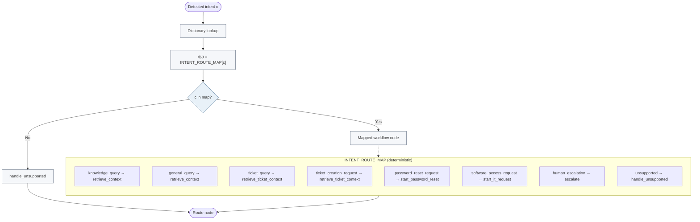
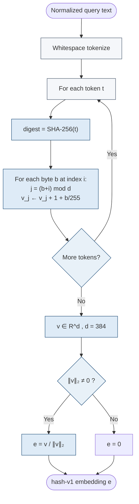
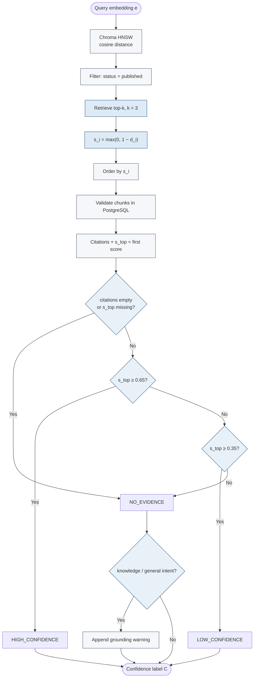
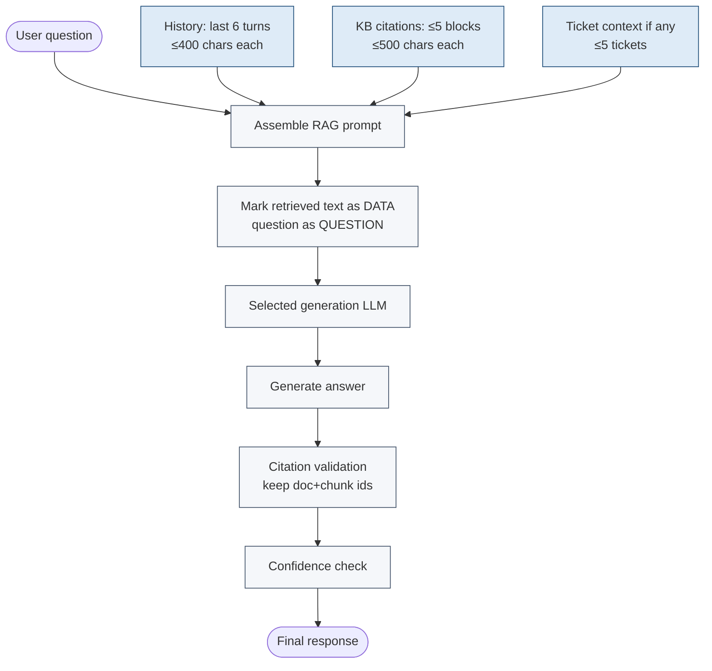
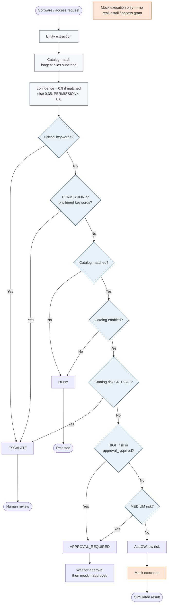
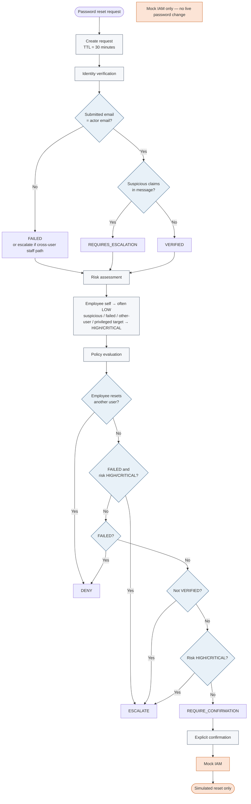

# AssistIQ — Algorithmic Flowcharts (Methodology Figures)

**Purpose.** Compact academic flowcharts of *backend algorithms* implemented in AssistIQ Baseline A.  
**Not included.** Frontend/UI architecture, deployment topology, or proposed (unimplemented) ML methods.  
**Source of truth.** Current repository implementation (intent, routing, hash-v1, Chroma retrieval, confidence, RAG, IT policy, password policy).

---

## FIGURE A — Intent Detection Algorithm

### Figure title
**Figure A.** Ordered keyword intent detection with optional lightweight override.

### Flowchart

```mermaid
flowchart TD
  A([User message x]) --> B[Lowercase / normalize ℓx]
  B --> C[Scan keyword groups in fixed order O]
  C --> D{∃ keyword w ∈ K_I<br/>with w ⊆ ℓx?}
  D -->|Yes| E[Select first matching intent I*]
  D -->|No| F{"?" ∈ x ?"}
  F -->|Yes| G[GENERAL_QUERY]
  F -->|No| H[KNOWLEDGE_QUERY]
  E --> I{I* = KNOWLEDGE_QUERY<br/>and optional model configured?}
  G --> I
  H --> I
  I -->|No| J([Output intent I*])
  I -->|Yes| K[Lightweight hit-rate heuristic<br/>NOT trained SVM / logreg]
  K --> L{Remap only if allowed<br/>by label map?}
  L -->|Yes| M[Override I*]
  L -->|No / error| J
  M --> J

  classDef decision fill:#E8F1F8,stroke:#1F4E79,color:#111
  classDef process fill:#F5F7FA,stroke:#44546A,color:#111
  classDef note fill:#FFF2CC,stroke:#BF8F00,color:#111
  class D,F,I,L decision
  class B,C,E,K,M process
  class G,H,J process
```

**Ordered groups O:**  
(1) HUMAN_ESCALATION → (2) PASSWORD_RESET_REQUEST → (3) SOFTWARE_ACCESS_REQUEST → (4) TICKET_CREATION_REQUEST → (5) TICKET_QUERY → (6) KNOWLEDGE_QUERY

### Mathematical representation

Let \(\ell(x)\) be the lowercased message and \(K_I\) the keyword set for intent \(I\). AssistIQ uses **substring** containment (not bag-of-tokens equality):

\[
I^{*}(x)=\min_{\prec}\{\,I\in O:\exists\,w\in K_I\text{ with }w\subseteq \ell(x)\,\}
\]

where \(\prec\) is the fixed order on \(O\). Fallback:

\[
I^{*}(x)=\begin{cases}
\texttt{GENERAL\_QUERY}, & \text{no keyword hit and ``?''}\in x,\\
\texttt{KNOWLEDGE\_QUERY}, & \text{no keyword hit otherwise.}
\end{cases}
\]

Optional override applies **only if** \(I^{*}=\texttt{KNOWLEDGE\_QUERY}\) and a lightweight registry model is configured; the adapter scores label keyword hit-rates and is **not** a fitted SVM/logistic model.

### Short explanation
Intent labels drive routing. The detector is a deterministic lexical heuristic: the first matching keyword group wins. That keeps Baseline A inspectable, but paraphrase-heavy utterances that avoid listed substrings fall through to general or knowledge intents unless the optional override remaps them.

### Figure caption
**Figure A.** Keyword-based intent detection in AssistIQ Baseline A (ordered substring match, “?” fallback, optional lightweight hit-rate override only for `knowledge_query`).

---

## FIGURE B — Deterministic Request Routing

### Figure title
**Figure B.** Dictionary-based intent-to-workflow routing.

### Flowchart



### Mathematical representation

\[
r(c)=\texttt{INTENT\_ROUTE\_MAP}[c],\qquad
r(c)=\texttt{handle\_unsupported}\text{ if }c\notin\mathrm{dom}(\texttt{INTENT\_ROUTE\_MAP}).
\]

### Short explanation
Routing does not classify text a second time. It applies a fixed map from intent strings to LangGraph nodes. Ticket-related chat intents both open ticket-context retrieval; they do **not** insert ticket rows. Errors in routing for Baseline A are therefore largely inherited from intent errors.

### Figure caption
**Figure B.** Deterministic dictionary-based request routing in AssistIQ (`INTENT_ROUTE_MAP`).

---

## FIGURE C — Hash-Based Query Embedding

### Figure title
**Figure C.** Deterministic hash-v1 embedding (\(d=384\)).

### Flowchart



### Mathematical representation

\[
j=(b+i)\bmod d,\quad
v_j\leftarrow v_j+1+\frac{b}{255},\quad
d=384,\quad
e=\frac{v}{\|v\|_2}\ (\|v\|_2\neq 0).
\]

**Label:** Deterministic Hash Embedding — `hash-v1` (no training).

### Short explanation
The embedding is a fixed transform of token digests into a unit vector. It is reproducible and server-light, which suits a frozen baseline. It does not learn synonymy; nearby vectors mainly reflect shared hashed token mass.

### Figure caption
**Figure C.** Hash-v1 query/document embedding used by AssistIQ Baseline A (\(d=384\), SHA-256 accumulation, L2 normalisation).

---

## FIGURE D — Knowledge Retrieval + Confidence

### Figure title
**Figure D.** Published-chunk retrieval (\(k=3\)) and top-score confidence heuristic.

### Flowchart



### Mathematical representation

\[
s_i=\max(0,1-d_i),\qquad
\mathcal{C}=\mathrm{TopK}(\{s_i\},k=3),\qquad
s_{\mathrm{top}}=s_{(1)}.
\]

\[
C(x)=\begin{cases}
\texttt{HIGH\_CONFIDENCE}, & s_{\mathrm{top}}\ge 0.65\ \wedge\ |\mathcal{C}|\ge 1,\\
\texttt{LOW\_CONFIDENCE}, & 0.35\le s_{\mathrm{top}}<0.65,\\
\texttt{NO\_EVIDENCE}, & \text{otherwise.}
\end{cases}
\]

Confidence uses **\(s_{\mathrm{top}}\)** (first citation), not the mean of all scores. Low retrieval confidence does **not** auto-escalate in Baseline A.

### Short explanation
Retrieval grounds later generation in published knowledge only. The confidence label is a threshold heuristic on the best hit, intended as an operational signal of thin evidence rather than a calibrated probability of answer correctness.

### Figure caption
**Figure D.** AssistIQ knowledge retrieval (\(k=3\), cosine HNSW, published filter) and top-citation confidence thresholds (0.65 / 0.35).

---

## FIGURE E — RAG Response Generation

### Figure title
**Figure E.** Retrieval-augmented prompt construction and generation.

### Flowchart



### Mathematical representation

Prompt composition (Baseline A limits):

\[
\mathrm{Prompt}=(\mathrm{System}_{\mathrm{DATA\text{-}only}},\, H_{1:6}^{\le 400},\, \{[KB\text{-}n]\}_{n\le 5}^{\le 500},\, Q).
\]

Generation uses an external LLM; AssistIQ does not train that model. Citation checks are structural; they do not prove entailment of every sentence.

### Short explanation
RAG separates untrusted retrieved passages from system instructions so document text cannot easily override control rules. The model answers from DATA plus the question. This reduces one failure mode (prompt injection from KB text) but does not eliminate hallucination or guarantee factual correctness.

### Figure caption
**Figure E.** AssistIQ RAG generation path: constrained prompt, registry LLM, citation scrubbing, and confidence labelling.

---

## FIGURE F — IT / Software Access Decision Algorithm

### Figure title
**Figure F.** Rule-based IT request policy with mock execution.

### Flowchart



### Mathematical representation

Extraction confidence (verified):

\[
\mathrm{conf}=\begin{cases}
0.9,& \text{catalog matched},\\
0.35,& \text{otherwise},
\end{cases}
\qquad
\mathrm{conf}\leftarrow\min(\mathrm{conf},0.6)\ \text{if type = PERMISSION}.
\]

Policy order: critical language → escalate; permission/privileged → escalate; no catalog → deny; disabled → deny; catalog CRITICAL → escalate; HIGH or `approval_required` → approval; MEDIUM → approval; else ALLOW (LOW) → mock execute.

### Short explanation
IT automation is intentionally non-generative at the decision layer. Catalog and keyword rules decide allow, deny, escalate, or approval. Terminal “success” in Baseline A is produced by `MockExecutionAdapter` and must not be read as a real install or entitlement change.

### Figure caption
**Figure F.** AssistIQ IT/software-access decision algorithm (rule hierarchy and mock execution).

---

## FIGURE G — Password Reset Decision Algorithm

### Figure title
**Figure G.** Password-reset verification, risk, policy, confirmation, and mock IAM.

### Flowchart



### Mathematical representation

Let \(e_s\) be submitted email, \(e_a\) actor email, \(v\) verification status, \(\rho\) risk level. After verification and risk assessment, policy follows (simplified from implementation order):

\[
\pi=
\begin{cases}
\texttt{DENY}, & \text{employee targets other user},\\
\texttt{ESCALATE}, & v=\texttt{FAILED}\wedge \rho\in\{\texttt{HIGH},\texttt{CRITICAL}\},\\
\texttt{DENY}, & v=\texttt{FAILED}\text{ otherwise},\\
\texttt{ESCALATE}, & v\neq\texttt{VERIFIED},\\
\texttt{ESCALATE}, & \rho\in\{\texttt{HIGH},\texttt{CRITICAL}\},\\
\texttt{REQUIRE\_CONFIRMATION}, & \text{otherwise}.
\end{cases}
\]

Expiry: request TTL \(=30\) minutes. Confirmation precedes mock IAM; no live password write occurs.

### Short explanation
Password handling keeps identity and risk decisions outside the LLM. Session email matching, risk rules, and policy gates precede any simulated reset. The thirty-minute TTL bounds abandoned requests. Mock IAM makes the academic prototype safe to demonstrate without changing real credentials.

### Figure caption
**Figure G.** AssistIQ password-reset decision algorithm (verify → risk → policy → confirm → mock IAM; TTL = 30 min).

---

## Consistency checklist

| Check | Status |
|-------|--------|
| Intent uses ordered substring keywords + “?” fallback | Matches `detect_intent.py` |
| Optional lightweight override only for `knowledge_query` | Matches |
| Routing map values | Matches `intents.py` |
| hash-v1 / \(d=384\) / SHA-256 / L2 | Matches `embedding_service.py` |
| \(k=3\), \(s=\max(0,1-d)\), confidence on **top** score | Matches retrieval + `confidence_check.py` |
| NO_EVIDENCE warning; no auto-escalate from RAG confidence | Matches |
| IT policy order + mock execution | Matches `policy_service.py` / mock adapter |
| Password TTL 30 min; mock IAM; policy hierarchy | Matches password services |
| No SVM/BERT/BM25/hybrid/real install/live password | Not claimed |

---

*Application source code was not modified. These figures are methodology artefacts for the research paper.*
